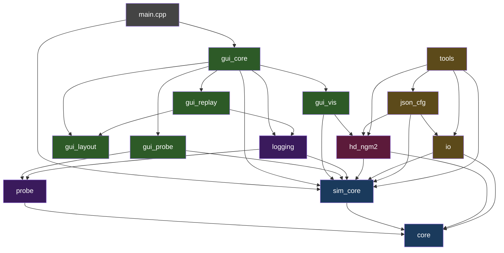

+++
title = "Architecture"
weight = 10
+++

# Architecture Overview

COAST is organized into **13 modules**, each in its own `include/<module>/` and `src/<module>/` directory pair. This section maps the full structure and the dependencies between modules.

## Module Map

## Module Categories

### Simulation Engine (blue)

| Module | Purpose | Key Files |
|--------|---------|-----------|
| **core** | Base types: entity hierarchy, structure registry, SIMD RNG | `entity_element.h`, `structure_registry.h`, `mt19937_simd.h` |
| **sim_core** | Simulation container, IO buffers, threading | `sim_env.h`, `io_entity.h`, `sim_thread_controller.h` |

### Neural Model (red)

| Module | Purpose | Key Files |
|--------|---------|-----------|
| **hd_ngm2** | The HD-NGM2 model: neuron groups with hierarchical dendrites | `hd_ngm2_neuron_group.h`, `hd_ngm2_neuron.h`, `hd_ngm2_dendrite.h` |

### Data & Configuration (yellow)

| Module | Purpose | Key Files |
|--------|---------|-----------|
| **io** | Dataset loaders (MNIST, CIFAR-10/100, dSprites, etc.) | `mnist_io.h`, `cifar10_io.h`, `dsprites_io.h` |
| **json_cfg** | JSON configuration parsing into typed structs | `json_loader.h`, `dataset_json.h`, `ngm2_json.h` |
| **tools** | `sim_builder` — constructs simulations from configs | `sim_builder_interface.h`, `sim_builder_cfg.h` |

### Instrumentation (purple)

| Module | Purpose | Key Files |
|--------|---------|-----------|
| **probe** | Real-time value observation with SPSC queues | `probe_instance.h`, `entity_probe_set.h`, `spsc_queue.h` |
| **logging** | HDF5/CSV logging: buffers, probes, state persistence | `buffer_logger.h`, `probe_logger.h`, `state_logger.h` |

### GUI Layer (green)

| Module | Purpose | Key Files |
|--------|---------|-----------|
| **gui_core** | SDL2 app framework, main GUI, browsers, editors | `gui_manager.h`, `entity_browser.h`, `config_editor.h` |
| **gui_vis** | Visualization system with factory registry | `vis_registry.h`, `ngm_flat_vis.h`, `ngm_tree_vis.h` |
| **gui_probe** | Probe browser and observer panel | `probe_browser.h`, `observer_panel.h` |
| **gui_layout** | Reusable force-directed graph layout with Barnes-Hut | `force_layout.h`, `graph_canvas.h` |
| **gui_replay** | Offline buffer replay from HDF5 logs | `buffer_replay_dialog.h`, `buffer_log_reader.h` |

## Third-Party Dependencies

| Library | Location | Purpose |
|---------|----------|---------|
| Dear ImGui | `3rd_party/imgui/` | Immediate-mode GUI framework |
| ImPlot | `3rd_party/implot/` | Plotting (time series, histograms) |
| ImNodeFlow | `3rd_party/ImNodeFlow/` | Node-graph editor widget |
| imgui-filebrowser | `3rd_party/imgui-filebrowser/` | File browser dialog |
| nlohmann/json | `3rd_party/json/` | JSON parsing |
| stb | `3rd_party/stb/` | Image loading/resizing |
| SDL2 | System | Window, input, OpenGL context |
| OpenGL | System | GPU rendering |
| TBB | System | Concurrent hash map (probes) |
| HDF5 | System | Data logging and state persistence |

{}
