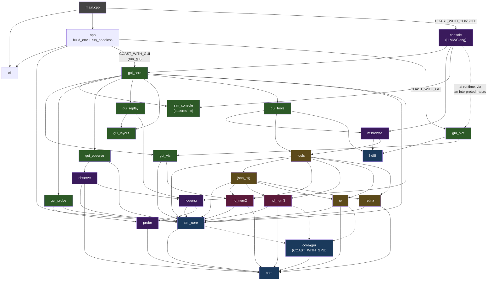

+++
title = "Architecture"
weight = 10
+++

# Architecture Overview

COAST is organized into a set of modules, each in its own `include/<module>/` and `src/<module>/` directory pair. This section maps the full structure and the dependencies between modules.

Two model families coexist: the original [hd_ngm2]({}) and the flat-SoA [hd_ngm3]({}). Since the *ngm3-gpu-port* cycle, COAST also supports **heterogeneous CPU/GPU execution** — individual entities can run on the GPU via the [core/gpu]({}) module (wgpu-native), with the `io_buffer` as the CPU↔GPU seam. The GPU layer is gated behind the `COAST_GPU_BACKEND` CMake option (`none`/`webgpu`/`null`, default `webgpu`) and is entirely absent from `=none` builds. See [Heterogeneous Execution]({}).

{}
**Scope of this page.** Everything below describes the modules that make up the
`coast` executable and its `coast_lib` / `coast_gui` archives. The repository also
builds **[coastd]({})**, a separate daemon process with its
own target tree (`coastd/`) and its own architecture. It is deliberately *not*
listed as a module here: it is not part of `coast_lib`, it depends on `coast_lib`
rather than the reverse, and `coast_lib`'s `include/` tree carries no coastd
headers. (The one client-side exception, `coastd_console`, is a *coast* module
that links the daemon's thin client — see the
[coastd section]({}) for the target layout.)
{}

## Two archives: `coast_lib` and `coast_gui`

The modules are compiled into **two** static libraries, and which one a module
lands in is the project's hard boundary between simulation and presentation:

| | contents | links |
|---|---|---|
| `coast_lib` | the headless core — `cli`, `app/build_env`+`run_headless`, `sim_core`, `hd_ngm2/25/3`, `inhibition`, `io`, `observe`, `logging`, `probe` (recording side), `json_cfg`, `retina`, `tools`, `hdf5`, `h5browse`, `core` (incl. `core/gpu`), `ngm`, `diag`, `run_config`, `coastd_console`, `campaign` | TBB + HDF5 only |
| `coast_gui` | everything that includes Dear ImGui, ImPlot, ImNodeFlow, SDL2 or OpenGL — `app/run_gui`, all `gui_*` modules, `probe/observers`, `sim_console` | `coast_lib` + SDL2 + OpenGL |

The arrow only ever points **coast_gui → coast_lib**; nothing in the core links
the GUI. That makes the separation a build-enforced property rather than a
convention — but the enforcement is worth stating exactly, because it is not
uniform:

* A core TU that includes an **ImGui-bearing** header fails to **compile** in
  every configuration: the imgui / implot / ImNodeFlow / SDL2 include roots
  belong to `coast_gui`, not `coast_lib`. This is the case that normally arises.
* A core TU that includes an **ImGui-free** `coast_gui` header — `gui_plot/figure.h`,
  `gui_core/console_iface.h` — compiles fine, since `include/` is a single project
  root shared by both archives. It fails to **link** only where `coast_gui` is
  absent: a `COAST_WITH_GUI=OFF` build, or a unit test linking bare `coast_lib`.
  In a default GUI build the `coast` executable pulls `coast_gui` in, so such a
  re-coupling would pass unnoticed.

The practical rule follows: **the headless build is what enforces the boundary.**
A GUI-only build cannot demonstrate that the core is GUI-free, so
`cmake --preset headless` (and `headless-tests`) belongs in routine validation,
not just in the occasional portability check.

`-DCOAST_WITH_GUI=OFF` (default `ON`) drops `coast_gui` entirely for a
**headless-only build**. SDL2 and OpenGL are then never searched for, ImGui /
ImPlot / ImNodeFlow are not compiled, and the [console]({})
is forced off — `console_panel` is itself an ImGui window. Such a build
configures and runs on a machine with no graphics stack at all, and produces
byte-identical simulation state to the full build.

Two module-level consequences worth knowing:

* `vis_hints_t` (`core/vis_hints.h`) and `demand_published`
  (`core/demand_published.h`) live in **core**, not under `gui_*`, despite their
  names suggesting otherwise. The shared reason is that both are GUI-free — plain
  PODs, plain atomics — but their situations differ, and it is worth being exact:
  `vis_hints_t` is genuinely *consumed* headlessly (parsed from the experiment
  config by `json_loader`, written into the HDF5 buffer-log topology by
  `buffer_logger`), whereas `demand_published`'s only consumers today are
  `gui_core`'s `buffer_browser` and `gui_manager`. It sits in core as a reusable
  concurrency primitive whose contract is worth testing in every configuration,
  not because the core calls it. Note that it is *demand-driven* — the producer
  recomputes only once the consumer has taken the last value — which is why
  [h5browse]({})'s event-driven scan
  engine deliberately uses a `latest_value` mailbox instead.
* `sim_console` (the `coast::simc` façade) is a **GUI-layer** module: its run
  dashboard and log viewers are ImGui windows and its only consumers are the
  console and `gui_manager`.

## Module Map

## Module Categories

### Simulation Engine (blue)

| Module | Purpose | Key Files |
|--------|---------|-----------|
| **core** | Base types: entity hierarchy, structure registry, SIMD RNG | `entity_element.h`, `structure_registry.h`, `mt19937_simd.h` |
| **core/gpu** | `gpu_device` seam + backends (`backends/webgpu`, `backends/null`), shared PRNG (`COAST_WITH_GPU`) | `gpu_device.h`, `backends/webgpu/gpu_context.h`, `shared_prng.wgsl` |
| **sim_core** | Simulation container, IO buffers (+ GPU variants), dispatcher, threading | `sim_env.h`, `io_entity.h`, `io_buffer.h`, `gpu_io_entity.h` |

### Neural Model (red)

| Module | Purpose | Key Files |
|--------|---------|-----------|
| **hd_ngm2** | The HD-NGM2 model: neuron groups with hierarchical dendrites | `hd_ngm2_neuron_group.h`, `hd_ngm2_neuron.h`, `hd_ngm2_dendrite.h` |
| **hd_ngm3** | Flat-SoA model (CPU + GPU): `neuron_group_t`, `neuron_group_gpu_t` | `hd_ngm3_neuron_group.h`, `hd_ngm3_gpu_neuron_group.h`, `hd_ngm3_gpu.wgsl` |

### Data & Configuration (yellow)

| Module | Purpose | Key Files |
|--------|---------|-----------|
| **io** | Dataset loaders (MNIST, CIFAR-10/100, dSprites, etc.) + the `mnist_io_gpu` sibling | `mnist_io.h`, `mnist_io_gpu.h`, `cifar10_io.h`, `dsprites_io.h` |
| **retina** | Centre-surround ON/OFF front end between a dataset node and the groups | `retina.h`, `retina_io.h`, `retina_cfg.h` |
| **json_cfg** | JSON configuration parsing into typed structs | `json_loader.h`, `dataset_json.h`, `ngm2_json.h` |
| **tools** | `sim_builder` — constructs simulations from configs | `sim_builder_interface.h`, `sim_builder_cfg.h` |

### Instrumentation (purple)

| Module | Purpose | Key Files |
|--------|---------|-----------|
| **probe** | Real-time value observation with SPSC queues | `probe_instance.h`, `entity_probe_set.h`, `spsc_queue.h` |
| **observe** | Offline value capture to per-group HDF5 files via a post-process `perform_observations` pass | `observe_accessor.h`, `observe_registry.h`, `observe_writer.h` |
| **logging** | HDF5 logging: buffers, state persistence | `buffer_logger.h`, `state_logger.h` |
| **hdf5** | Process-wide single-threaded libhdf5 serialization: one executor, all HDF5 I/O | `executor.h`, `handle.h` (with the RAII layer in `logging/hdf5_utils.h`) |
| **h5browse** | GUI-free offline HDF5 log-file browser (Analysis menu): family detection, chunked scan/stats/histogram/pairwise | `file_model.h`, `scan_engine.h`, `chunk_cache.h` |
| **console** *(COAST_WITH_CONSOLE)* | Embedded clang-repl C++ interpreter over an open HDF5 file. The **only** LLVM-linked target (`coast_console`); reaches the GUI through the `console_iface` seam so `coast_lib` stays LLVM-free | `repl.h`, `session.h`, `console_panel.h` |
| **coastd_console** | Console façade for driving a [coastd]({}) daemon (`coast::coastd`): connect, submit, list, cancel, discover. An interpreter parse boundary — no json, no sockets in the header | `coastd_console_api.h` |

### GUI Layer (green)

Every module below is compiled into **`coast_gui`** and exists only in a
`-DCOAST_WITH_GUI=ON` build (the default).

| Module | Purpose | Key Files |
|--------|---------|-----------|
| **gui_core** | SDL2 app framework, main GUI, browsers, editors | `gui_manager.h`, `entity_browser.h`, `config_editor.h` |
| **gui_vis** | Visualization system with factory registry | `vis_registry.h`, `ngm_flat_vis.h`, `ngm_tree_vis_v2.h`, `ngm3_flat_vis.h`, `ngm3_tree_vis.h` |
| **gui_probe** | Probe browser and observer panel | `probe_browser.h`, `observer_panel.h` |
| **gui_observe** | Observer Capture panel — group state, ranges, triggers | `observe_panel.h` |
| **gui_layout** | Reusable force-directed graph layout with Barnes-Hut | `force_layout.h`, `graph_canvas.h` |
| **gui_replay** | Offline buffer replay from HDF5 logs | `buffer_replay_dialog.h`, `buffer_log_reader.h` |
| **gui_tools** | Sim-independent analysis panels: Metric Explorer, HDF5 Browser, and the [coastd]({}#the-gui-panel) queue/submit panel | `metric_explorer.h`, `h5_browser_window.h`, `matrix_canvas.h`, `coastd_panel.cpp` |
| **gui_plot** | Live ImPlot figures for interpreted console macros: 6 kinds, PNG/HDF5 export, themes. Flat by design (no factory) and every macro-reachable header is ImGui-free — clang-repl parses them at runtime | `console_plot.h`, `figure.h`, `plot_manager.h` |
| **sim_console** | The `coast::simc` sim-control façade for the console: edits a config and spawns headless `coast` subprocesses. GUI-layer because its run dashboard and log viewers are ImGui windows | `sim_console_api.h` |
| **probe/observers** | The concrete probe observers (scalar, time series, histogram, CSV). All render through ImGui; the recording side of the probe system stays in `coast_lib` | `scalar_observer.h`, `time_series_observer.h` |

## Third-Party Dependencies

| Library | Location | Purpose |
|---------|----------|---------|
| Dear ImGui | `3rd_party/imgui/` | Immediate-mode GUI framework |
| ImPlot | `3rd_party/implot/` | Plotting (time series, histograms) |
| ImNodeFlow | `3rd_party/ImNodeFlow/` | Node-graph editor widget |
| imgui-filebrowser | `3rd_party/imgui-filebrowser/` | File browser dialog |
| nlohmann/json | `3rd_party/json/` | JSON parsing |
| stb | `3rd_party/stb/` | Image loading/resizing |
| SDL2 | System | Window, input, OpenGL context |
| OpenGL | System | GPU rendering |
| TBB | System | Concurrent hash map (probes), `parallel_for` |
| HDF5 | System | Data logging and state persistence |
| wgpu-native | FetchContent (v29.0.0.0) | WebGPU compute backend for GPU entities (`COAST_GPU_BACKEND=webgpu`); Vulkan on Linux, Metal on macOS |

{}
