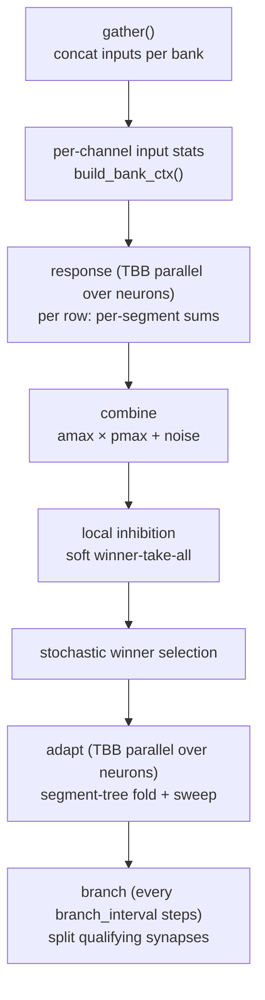

+++
title = "hd_ngm3"
weight = 32
+++

# hd_ngm3 — Flat-SoA Neural Model (CPU + GPU)

HD-NGM3 is a ground-up re-implementation of the [HD-NGM2]({}) model around a **flat, group-owned Structure-of-Arrays (SoA) layout**. The neural *behaviour* is conceptually the same — permanence-based synapses, a binary tree of dendritic segments, stochastic winner-take-all, Hebbian learning, mismatch-driven branching — but the *memory layout* is completely different, and that difference is the whole point.

The module contains two entities:

- **`neuron_group_t`** — the CPU implementation (multi-threaded with TBB).
- **`neuron_group_gpu_t`** — the GPU implementation (wgpu compute kernels), added by the *ngm3-gpu-port* cycle.

```
include/hd_ngm3/
├── hd_ngm3_neuron_group.h          # CPU entity, flat-SoA storage
├── hd_ngm3_cfg.h                   # params (bank_t, input_route_t: ngm/bank.h)
├── hd_ngm3_host.h                  # validate_params, bank_inputs_t, route_inputs, checkpoint parts (CPU+GPU)
├── hd_ngm3_cold_init.h             # cold_init (the CPU/GPU cold RNG contract)
├── hd_ngm3_layout.h                # check_bank_layout (value + replica layout laws)
└── hd_ngm3_gpu_neuron_group.h      # GPU entity (COAST_WITH_GPU only)

src/hd_ngm3/
├── hd_ngm3_neuron_group.cpp        # full CPU algorithm
├── hd_ngm3_cold_init.cpp           # cold_init, shared by CPU init_storage and GPU build_step_plan
├── hd_ngm3_host.cpp                # validation, input routing, checkpoint shape/bank staging, shared by CPU and GPU
├── hd_ngm3_layout.cpp              # the layout check, shared by CPU and GPU load_state
├── hd_ngm3_gpu_neuron_group.cpp    # GPU host orchestration + readback
└── hd_ngm3_gpu.wgsl                # the compute kernels
```

## Why Flat-SoA?

NGM2 models the biology directly: a group owns neurons, each neuron owns dendrites, each dendrite owns its synapse arrays. That object graph scatters allocations across the heap, hurts cache locality, and has no clean path to the GPU.

NGM3 collapses the whole hierarchy into **flat arrays owned by the group**. There are no `neuron` or `dendrite` objects — only contiguous vectors indexed by computed offsets. The header states the intent plainly: *flat-SoA aimed at SIMD / GPU*. This is what lets `neuron_group_gpu_t` be a near-direct port: the CPU `std::vector<float>` arrays become `WGPUBuffer`s of identical shape, and the indexing arithmetic is the same on both sides.

## Two Banks

Every neuron has two dendrite banks:

- **proximal** — the main driver (always present, ≥1 dendrite).
- **apical** — a top-down modulatory gate (optional; `apical_cnt` may be 0).

The combined per-neuron activation is

```
neuron_act = clamp(apical_max × proximal_max + noise, 0, 1)
```

When the apical bank is absent, `apical_max` defaults to `1.0`, so the apical term becomes a no-op and proximal alone drives the neuron.

## The Flat-SoA Layout

All storage is group-level. Per bank (each shaped `neuron_cnt × dendrite_cnt × rep_cnt × input_size`, except `rep_act`):

| Array | Type | Shape | Role |
|-------|------|-------|------|
| `*_permanences` | `float` | n·d·rep·in | synaptic weight [0,1] |
| `*_segment_ids` | `uint8_t` | n·d·rep·in | which segment-tree node a synapse belongs to |
| `*_adapt_history` | `float` | n·d·rep·in | accumulated learning effort (Σθ) |
| `*_mismatch` | `float` | n·d·rep·in | IIR-smoothed input/permanence disagreement |
| `*_rep_act` | `float` | n·d·rep | per-representation activity |
| `*_input_buf` | `float` | in | concatenation scratch for this bank's inputs |

Per-neuron scratch (all `float`, length `neuron_cnt`): `neuron_apical_max`, `neuron_proximal_max`, `neuron_act`, `neuron_mx_act` (a slowly-decaying running max of activity, `×0.99999` each step).

Input routing is held in a `bank_inputs_t` per bank — parallel vectors of channel `ids`, `sizes`, prefix-sum `offsets`, and the resolved `io_buffer*` pointers (populated by `set_input_buffer`). It, the routing itself (`route_inputs`) and the configuration contracts (`validate_params`, the GPU's 32-bit `branch_interval` limit passed as a cap) live in `hd_ngm3_host.h`, shared by the CPU and the GPU group, so a config one refuses the other refuses too. `gather()` copies each routed input channel's `cur_read_buffer()` span into the bank's `input_buf` at its offset.

Two derived constants shape everything: `rep_cnt = 2^max_branch_level` and `max_seg_id = 2^(max_branch_level+1) − 1` (the segment tree is heap-indexed: root = 1, children = 2i, 2i+1; `max_branch_level ≤ 4`, so at most 32 segment slots).

## The Per-Step Algorithm (CPU)

`process()` runs these phases in order:



1. **Gather + stats.** Each bank concatenates its inputs, then `build_bank_ctx()` computes `input_stats_t` (sum, avg, true-max, 1 − Hoyer) **per input channel** via the shared `ngm2::compute_input_stats()` helper (the same one ngm2 uses — see [hd_ngm2]({})) and expands them to per-input-position arrays, as ngm25's step context does: the channel's `1/sum` and draw range `max/2` for the penalty, and the channel's attenuation (`ngm2::learning_noise_window`) and high/low threshold for adaptation. Bank-wide values are the total sum (the leaf normaliser), the max over channels (the mismatch normaliser), and the response attenuation (`ngm2::response_noise_window`) from the minimum 1 − Hoyer and minimum average over the channels that carry input and have more than one entry — the noise gate described in [hd_ngm2]({}). With one channel these equal the pooled statistics. "True max" means reduced from `0.0`, with no `1.0` floor.

2. **Response** (`tbb::parallel_for` over neurons). Each `(dendrite, rep)` row holds one root-to-leaf path. A connected synapse (`p > permanence_threshold`) adds its input to **its segment's** sum; if the random draw `U(0, max_c/2)` exceeds its input, a **stochastic penalty** `perm_strength × (1 − input·inv_sum_c)` is subtracted (`_c`: the synapse's input channel) and that segment's sum is clamped at 0. The draw is made **once per synapse per step**: rows that hold the same segment for an input are copies of one synapse and reuse its outcome. The row's activity is the sum of its path's segment sums (root to leaf, ngm2's order), scaled by the noise-gate *attenuation* (1 − Hoyer and avg) (noisy or flat inputs are suppressed) and `1/total sum`, and clamped into `rep_act`. This is ngm2's response computed on the replicated layout (SPEC.md M.0.6).

3. **Combine.** Per neuron, `apical_max` / `proximal_max` are the max over that neuron's `rep_act` slice; `neuron_act = clamp(apical_max × proximal_max + noise, 0, 1)`; `neuron_mx_act` decays and takes the running max.

4. **Inhibition + winner.** The group's swappable `inhibition::inhibitor_t` (default `max_softmax`, `out = max · exp(−β · (max − v))`) inhibits the group output — see [inhibition]({}). Then a stochastic winner is drawn: `win_act` is sampled uniformly in `[mx_act × stochastic_win_thres, mx_act]` and the winner is drawn uniformly among the neurons whose output + ε ≥ `win_act` — by a second draw, so no neuron is favoured by its index (`ngm2::pick_winner`, SPEC.md M.4.4). The adapt pass gates the winner and the other neurons with their own tracked learning windows, and the window edges then advance with this step's activities ([activity window tracking]({})). On the GPU, `winner_main` does both: it copies the current edges into `adapt_scalars[4..7]` for `adapt_main` and advances the device edge buffer.

5. **Adapt** (`tbb::parallel_for` over neurons). Per dendrite, segment *weights* are pre-computed by a **bottom-up tree fold**: leaves get `primary_learning_rate` (winner) or activity-scaled `secondary_learning_rate`, then each parent takes `max(children)`. The synapse sweep then applies a per-synapse learning magnitude `θ`, performs the Hebbian permanence update, accumulates `adapt_history += θ`, and IIR-smooths `mismatch`.

6. **Branch** (only when `++input_cnt % branch_interval == 0`). Per dendrite, four passes compute `mm_avg` and `mm_std` over distinct segments, derive a mismatch threshold, count qualifying synapses (`adapt_history ≥ accumulated_theta_thres`, `mismatch ≥ thres`, child fits the tree), and — if the per-dendrite count clears `min_mismatch_percentage` — **split** each qualifier into two child segments (`old_sid → 2·sid, 2·sid+1`) with permanences jittered ±0.1 and history/mismatch reset. This grows `total_representation_count` over long runs.

### RNG

A master `rgen` (`fast_rng_t` = `rng_t<mt19937_simd>`) is seeded from `random_seed + seed_offset`. It then seeds one **per-neuron** RNG each (`neuron_rgens[n]`), so the parallel response/adapt loops draw from independent streams with no atomics and full reproducibility. The master's next draws are the cold permanences (rep 0 of every apical dendrite, then of every proximal one; the other reps are copies). That whole sequence is one function, `ngm3::cold_init()` (`hd_ngm3_cold_init.h`), which the CPU group's `init_storage` and the GPU group's `build_step_plan` both call: a CPU and a GPU group built from one config start with bit-identical permanences, and a change to the seeding order changes both. Per-neuron draws happen in response (`low_dis`) and combine (`noise`); the master RNG draws the winner threshold and branch permanence jitter.

### Frozen Inference Mode (CPU)

In a frozen run (the config's top-level `frozen`, SPEC.md M.7.6) the CPU `compute_step` of every ngm3 group switches to pure inference: after inhibition it returns, skipping the winner draw, adapt pass, branch section, and the `input_cnt` increment (which keys the branch gate); the `neuron_mx_act` update sits after that return, so it is skipped too. Only the per-neuron noise RNG advances.

**Zero group output.** A step whose post-inhibition output is all 0 is handled the same way on the CPU, decided per step: the output is written and nothing in the learning state changes (SPEC.md M.4.15).

**The checkpointed `input_cnt` counts learning steps.** A checkpoint stores the branch counter as `input_cnt`: the CPU group's `input_cnt`, and the GPU group's device-resident count, read back for the save. It counts learning steps, i.e. steps that are neither frozen nor zero-output (SPEC.md M.6.1). Before zero-output steps stopped being learning steps, it counted every non-frozen step, zero-output ones included. The two counts therefore differ only by the zero-output steps of a run:

- With `max_softmax` inhibition, an output is 0 only when its neuron's activity is 0, which the default baseline neuron noise rules out. So the counts differ only under a zero noise range.
- With `random_index` inhibition, which subtracts, every output can be 0 while the activities stay positive, at any noise (SPEC.md M.4.15).

An older checkpoint loads as it is: nothing refuses or converts its count. A resumed run's branch checks are then offset by the number of zero-output steps before the save.

**Why zero learning rates are not enough** is the same as for ngm2: mismatch EMA, the decaying `neuron_mx_act` (`*= 0.99999; max(...)`), and mismatch-driven branching all mutate persisted state at lr=0, as confirmed by empirical measurement. `frozen=true` gates all three.

**On `load_state` the configuration wins**, as in ngm2 (SPEC.md M.7.8), frozen or not: the checkpoint's configuration record (`ngm3::config_record`, shared by the CPU and GPU group) is compared with the current settings and each difference reported, and no setting is read back. The seed is random state, not a setting: the CPU group restores its RNG streams, the GPU group restores `effective_seed` (its per-step draws are keyed on it), so a resume continues the checkpointed streams under any configured seed. A GPU checkpoint loaded on the CPU keeps the CPU's fresh, config-seeded streams — the two derive their draws differently (M.7.16).

**`load_state` refuses a bank that breaks the replica layout.** A segment that spans several replica rows is one logical synapse copied into each, and the compute relies on that: the CPU response reuses row r−1's penalty draw when the segment id repeats, and the split (CPU and GPU kernel) rewrites a whole run from its first row. `ngm3::check_bank_layout` (`hd_ngm3_layout.h`) checks every cell's value — permanence in [0, 1], adapt history finite and ≥ 0, mismatch finite (L1; a NaN copied into every row of its run would pass the bitwise compare below) — and, per (neuron, dendrite, input) column: every id is in [1, 2^(L+1)−1], each run starts at its segment's rows and fills them, and the rows of a run hold bitwise-equal permanence, mismatch and adapt history. Learning keeps these properties, so only a loaded state can break them. The CPU and GPU groups read both banks, run the check, and only then assign or upload anything. A violation throws `corrupt checkpoint — <bank> bank: <column, row, law>` and leaves the group unchanged, the same fail-fast contract as ngm25's `check_arena_consistency`. The other refusals run before it: a checkpoint of another shape throws `checkpoint does not fit this group`, and a missing bank, a bank array of the wrong length, a wrongly sized `neuron_mx_act`, an incomplete RNG stream or a per-neuron stream missing from a present `neuron_rgens` throws `corrupt checkpoint` (an absent `neuron_mx_act` is a pre-field checkpoint and keeps the constructed value) (see [logging]({})), all before anything is assigned or uploaded.

### Key Parameters (`hd_ngm3_cfg.h`)

| Parameter | Role |
|-----------|------|
| `neuron_cnt`, `apical_cnt`, `proximal_cnt` | group / per-neuron dendrite counts (apical may be 0) |
| `max_branch_level` | segment-tree depth ⇒ `rep_cnt = 2^depth` |
| `permanence_threshold` | synapse efficacy cutoff |
| `local_inhibition_strength` | Beta of the default max_softmax inhibition (no `inhibition_cfg`) |
| `stochastic_win_thres` | winner-selection range (fraction of max) |
| `primary` / `secondary` / `common_learning_rate` | learning rates (winner / non-winner-segment / global drift) |
| `weight_filter` | sigmoid shape gating learning strength (the learning window itself is tracked, see [hd_ngm2 → Activity Window Tracking]({})) |
| `mismatch_act_thres`, `mismatch_smoothing` | mismatch computation + IIR pole |
| `branch_interval`, `min_mismatch_deviation`, `accumulated_theta_thres`, `min_mismatch_percentage` | branching gates |
| `neuron_noise_range` | inference-time noise added at combine |
| `frozen` | Freeze learning — skip winner, adapt, branch, mx_act updates (see Frozen Inference Mode above) |

---

## The GPU Variant — `neuron_group_gpu_t`

`neuron_group_gpu_t` derives from `sim::gpu_io_entity` (not from `neuron_group_t` — the two share the flat-SoA *layout* and parameter set, but diverge entirely in compute expression). It is config-constructible by `sim_builder` from the **same** `ngm3` neuron-group config as the CPU type, plus a `gpu_context&`.

### GPU Storage

The CPU `std::vector` arrays become `WGPUBuffer`s of identical shape. Per bank: `permanences`, `segment_ids` (`u32` on the GPU — widened from the CPU `u8` — narrowed back on readback), `adapt_history`, `mismatch`, `rep_act`, `input_buf`, and a 4-float `stats` buffer. Per-neuron scratch (`apical_max`, `proximal_max`, `act`, `mx_act`) and a `group_outp` buffer mirror the CPU scratch. Small uniform buffers carry the per-step parameters (`Params`, `AdaptParams`, `BankDims`). **There is no per-neuron RNG state** — the stochastic draws use the stateless PCG hash from [`shared_prng.wgsl`]({}).

A dedicated `group_outp_` buffer is worth calling out: the post-inhibition output is published into it every step (via `CopyBufferToBuffer` from the `io_buffer` write page) so that the winner and adapt kernels have a **swap-invariant** read source, independent of the double-buffer index flip.

### Per-Step Kernel Sequence

`process()` writes the uniform buffers (host bookkeeping) and `record()` appends the kernel dispatches onto the phase-1 encoder, lazily compiling pipelines on first use:

1. **Gather** — per-bank `CopyBufferToBuffer` from each routed input's GPU read page into `input_buf`.
2. **Stats** — one workgroup per input channel → `{sum, avg, true-max, 1 − Hoyer}` (256-thread tree reduce of the sum, sum of squares, max and count; 1 − Hoyer matches `ngm2::hoyer_noise`). The gate windows are prepended to the shader source as WGSL constants generated from `ngm2::response_noise_window` / `learning_noise_window`, so the kernels carry no copies of the values.
3. **Fused response + combine** — *one workgroup per neuron* (64 threads). Each thread takes `(dendrite, rep)` rows and computes the CPU's per-segment response, drawing `pcg_uniform(key)` in place of the CPU `low_dis`; the key is built from the **logical synapse** (dendrite, segment, input), not the row, so every copy of a synapse draws the same value. The kernel binds the banks' segment ids and per-position channel index. Threads tree-reduce the per-bank max, then thread 0 combines into `neuron_act`. (Step 2 before it, `stats_main`, runs one workgroup per input channel.)
4. **Local inhibition** — single workgroup, writes the `io_buffer` write page.
5. **Publish** — `CopyBufferToBuffer` write page → `group_outp_`.
6. **Winner selection** — single workgroup; max/sum/stochastic `win_act`, then thread 0 picks the winner uniformly among the neurons clearing it (the same rule as the CPU, own stateless draw) → `adapt_scalars` (`f32` values stored as `bitcast<u32>`). On a learning step — the group output does not sum to 0 (SPEC.md M.4.15) — it also updates the running max `neuron_mx_act` and advances the device-resident learning-step counter `learn_cnt` (`[count lo, count hi, count % branch_interval, due]`), setting `due` when the count reaches a multiple of `branch_interval`. On a zero-output step it changes neither.
7. **Adapt** — one workgroup per neuron per bank; returns at once on a zero-output step (`act_sum == 0`): thread 0 folds the segment tree into workgroup-shared memory, all threads sweep `(rep, syn)` cells. *(Recorded from S7 on.)*
8. **Branch** — always recorded; the kernel returns early unless `learn_cnt`'s `due` flag is set — the CPU's `(++input_cnt) % branch_interval == 0`. The count lives on the device because only the device knows, mid-step, whether the step learned; the host reads it back only for checkpoints and the visualisation mirror. One workgroup per neuron per bank, thread-per-dendrite, multi-pass mm-stats + split-write; the split jitter's key includes a per-bank salt so apical and proximal cells draw independently. *(S8.)*

The response and adapt kernels compute the same arithmetic as the CPU group; the divergence from the CPU is **only** the PRNG (stateless hash vs. mt19937 stream), so the stochastic parts are compared statistically (see [Decisions]({}), ADR-5, and `ngm_parity_probe`). One arithmetic caveat: whether a multiply-add is fused (FMA) is up to the CPU compiler and the shader compiler, and they need not agree. That only matters where a result is compared with a threshold it lands within an ulp of — notably the ~7 % of initial permanences that start at exactly τ, whose first update decides the mismatch branch (`pnew > τ`). There CPU and GPU can legitimately take different branches, one more reason the GPU goldens compare in aggregate and why `impl_equivalence_gpu` checks that case frozen.

### Frozen Inference Mode (GPU)

When `frozen = true`, `build_step_plan` omits the winner, adapt, and branch ops — the static plan never dispatches the learning kernels, so the running max and the learning-step counter (both updated by the winner kernel) hold, mirroring the CPU group. (The `frozen` field of the `Params` uniform no longer gates anything; it is kept so the uniform's layout is unchanged.) `step_` keeps advancing — it keys the stateless PCG noise hash, the device analogue of the per-neuron RNG. `read_probes` skips the `adapt_scalars` readback (the winner kernel never wrote it), so the `max activity` / `winning thres` probes report 0. That is a deliberate cross-path divergence — the GPU probes publish constant 0 (the `PROBE()` calls must run for discoverability), a frozen ngm2 group's probes fall silent, and the ngm3 CPU group exposes none — accepted under the relaxed CPU↔GPU observe-parity stance; don't read the zeros as collapsed activity. The A-tier GPU goldens confirm frozen=false is bit-identical to the pre-frozen path.

### Observability

GPU-resident state is not directly CPU-visible, so three readback paths exist, each **gating only the GPU→CPU copy** on whether anyone is looking:

- **Probes** — `read_probes()` (called by the dispatcher after the phase-1 submit) emits `PROBE()` for `max activity`, `winning thres`, `activity sum`, `winner`. The kernels write these unconditionally every step; the readback of `adapt_scalars` happens only when `any_probe_active()`.
- **OBSERVE** — emitted from a `perform_observations` override that runs in the post-process observation pass (no longer inline in `read_probes()` / `process()`). Each GPU→CPU readback is gated on `acc.group_active("population")`, and the group's input and output vectors are emitted under the `population` group:
  - `population/in` — the gathered **proximal** input the group received this step: the presented sample, read back from `proximal_ids_.input_buf`. Mirrors ngm2's `population/in` so an eval harness can align the two models on the same channel.
  - `population/in_apical` — the gathered **apical** (top-down / context) input, read back from `apical_ids_.input_buf`, emitted only when an apical bank is configured (`apical_input_size > 0`).
  - `population/out` — the post-inhibition population vector, read back from the stable `group_outp_`.

  The CPU `neuron_group_t::perform_observations()` emits the same `population/in` / `population/in_apical` / `population/out` channels directly from its host-side `proximal_input_buf` / `apical_input_buf` / `group_outp` members (no readback), which stay stable end-of-step. CPU↔GPU observe parity is intentionally relaxed — no cross-device contract or parity test — but the channels carry the same semantics. Separately, the presented **source index** rides the model-agnostic `input/index` channel that every dataset loader emits from its own `perform_observations`, so a run with the `input` and `population` observe groups enabled yields `input/index`, `population/in`, and `population/out` per step — the trio an external harness needs to align model output with the data shown.
- **Visualization mirror** — `refresh_vis_mirror()` does a bulk GPU→CPU copy of permanences and segment-ids into CPU mirrors, **consumer-pulled** (the visualizer calls it on demand during the post-swap barrier window, possibly very infrequently). The entity never auto-refreshes. Accessors (`get_apical_representation()` etc.) index the mirrors with the same flat-SoA offset arithmetic as the CPU type, so the existing NGM visualizers work unchanged.

**Readback failures** (#234). `gpu_device::readback` reports a failed transfer by returning `false`; the GPU groups (ngm3 and ngm25 alike) never turn that into zeros. A failed read of learned state — every read `save_state` makes (counter, each bank's arrays, `neuron_mx_act`, window edges), and ngm25's growth sync — throws `std::runtime_error`, so the checkpoint fails before it is published (`--checkpoint` logs and skips it, the GUI reports it, a final `--save-state` exits 1) and the last good file stays in place. ngm25 stages its arena readback (perm / adapt_hist / mismatch / `neuron_mx_act`) and does every read of a growth sync before committing anything, so a failure leaves counters, host arena and device untouched. Observation readbacks throw too (and halt the run): their rows are recorded data. The two diagnostic paths do not throw: a failed probe readback publishes nothing that step, and a failed `refresh_vis_mirror()` (GUI thread) logs a warning and keeps the last good mirror.

See [Threading]({}) for how these readbacks ride the existing per-step barrier, and the [probe module]({}) for the probe/observer machinery they feed.
