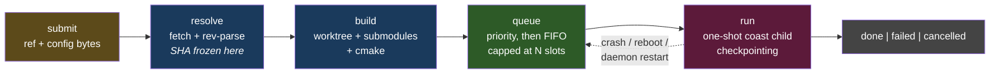

+++
title = "coastd"
weight = 45
+++

# coastd — the Headless-Job Daemon

`coastd` is a resident, per-machine background service that runs COAST
simulations headless on stable — possibly remote — machines, so that long batch
runs (hours to days) **survive the loss of the client that started them**.

It is not part of the `coast` executable. It is a separate process, built from a
separate target tree (`coastd/`), that **orchestrates subprocess `coast`
binaries** and never re-embeds the simulator. Everything else in this
documentation describes one program; this section describes a second one that
runs the first.

## Why it exists

Before `coastd` there were exactly two ways to run a simulation: the interactive
GUI, and a local headless run launched from the
[REPL console]({})'s `coast::simc`
façade. Both tie a run's lifetime to a workstation staying awake with a process
up. For a multi-day hyperparameter sweep that is fragile in a way that has
nothing to do with the science: a closed laptop lid, a VPN drop, or a GUI crash
loses days of compute.

`coastd` breaks that coupling. A client submits a job — **config content plus a
committed git ref** — and then may disconnect entirely. The daemon owns the rest
of the job's life.

Its single most distinctive capability is **on-demand native build from a git
ref**. A collaborator on macOS can push a feature branch and tell the Linux
server to *build and run that branch there, natively*. No cross-compilation, no
binary shipping, no "which build is this?" — the resolved commit SHA **is** the
code identity, frozen at submit time.

## What it does, in order

The dashed edge is the headline promise: an interrupted job goes **back into the
queue**, not into a failure state, and resumes from its newest checkpoint. That
edge is not a special case bolted onto the happy path — it is the same code.

## The governing principle

From the project's Discover stage, and stated by the project owner as a firmly
held position:

> Build, scheduling, and persistence are **not three separable features** to ship
> incrementally — they are **three views of one job-lifecycle state machine over
> one persistence model**, and must be designed together up front.

The reason is a genuine dependency cycle, not tidiness:

- **build** produces the per-SHA binary that **scheduling** launches;
- **scheduling** produces the running children that **persistence** tracks and resumes;
- **persistence** holds the job set from which the SHA refcount — which **build**'s
  garbage collection consumes — is derived.

Shipping any one of the three first would have meant inventing a stand-in for the
other two and then throwing it away. The design realizes the principle concretely:
the state machine is a **single pure function**, `reconcile`, and the most
valuable property that buys is that the **recovery path is identical to the
steady-state path**. There is no separate recovery code to rot, because there is
no separate recovery code.

See [Reconcile & Recovery]({}) for how that works and why
it is the central robustness lever.

## Reading order

1. **[Architecture]({})** — the subsystems, the
   single-writer core loop, and the coupling invariant that makes the whole thing
   analyzable.
2. **[Reconcile & Recovery]({})** — the pure state
   machine, the derived-not-stored discipline, and the R1 recovery model.
3. **[Persistence & the Child Contract]({})** — the
   git-versioned job store, the two-tree layout, and exactly how a `coast` child
   is launched, tailed, and resumed.
4. **[Protocol & Clients]({})** — the JSONL wire, the thin
   client library, the console and GUI frontends, and discovery.
5. **[Boundaries]({})** — what it does not handle, where
   it is known to be weak, and the security posture. **Read this before
   deploying.**

These pages cover *how coastd works and why*. They are not an installation
guide: `coastd --help` lists the flags, `coastd --install-service` writes a
systemd user unit, and
[Persistence]({}) plus [Boundaries]({})
carry the operational facts that shape a deployment — the directory roots, the
config knobs that matter, and the sharp edges.

## Scope — what coastd is not

These are hard exclusions from the Discover stage, not gaps awaiting work:

| Not in scope | Why |
|---|---|
| Cross-compilation / shipping binaries | The whole point is native build on the target. |
| Running uncommitted code | A committed git ref is the *only* accepted code identity. Reproducibility depends on it. |
| Transferring results back to the client | The filesystem **is** the output surface; retrieval is out-of-band (NAS, sshfs). |
| Provisioning datasets | An operator precondition. `coastd` only *advertises* well-known locations. |
| Authentication / isolation | The network plus git-push access **is** the trust boundary. See [Boundaries]({}) — this has teeth. |
| Live probe-visualization streaming of remote jobs | Explicitly removed during Discover; it will never exist in this context. |

One capability is deliberately *not precluded but not built*: a coordinated
**multi-daemon pool** with resource-aware packing. The design avoids anything
that would make it harder later (there is no cross-machine state, and the client
is stateless), but builds nothing toward it.

{}
**Status.** `coastd` is complete and tested on **Linux/systemd**, the primary
target. It also runs on **macOS**, where its test suite passes, but only started by
hand: the launchd template has never been run, so do not run `coastd` unattended on
macOS. See [Boundaries]({}#macos--supported-but-not-unattended).
{}
