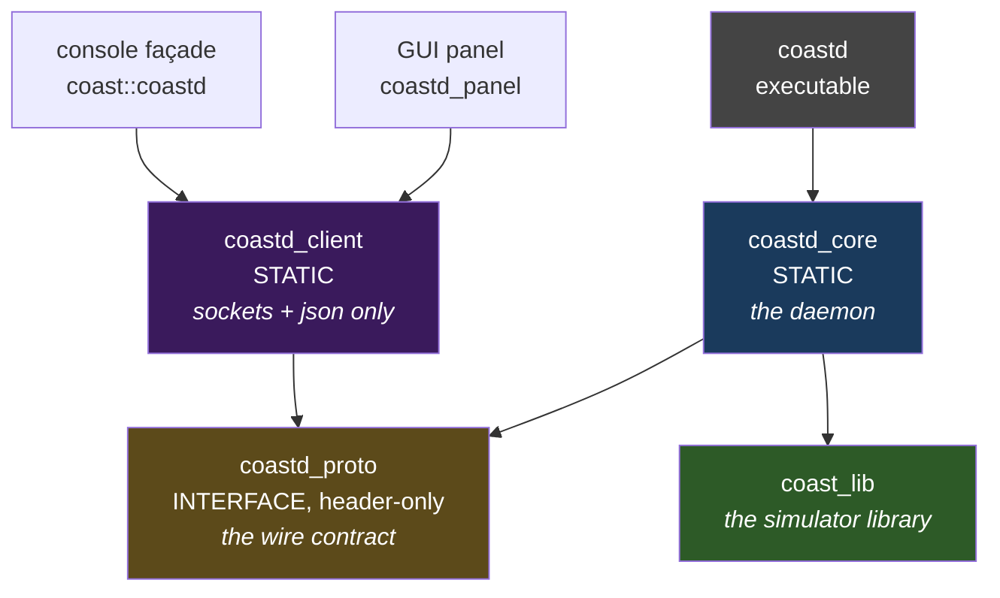
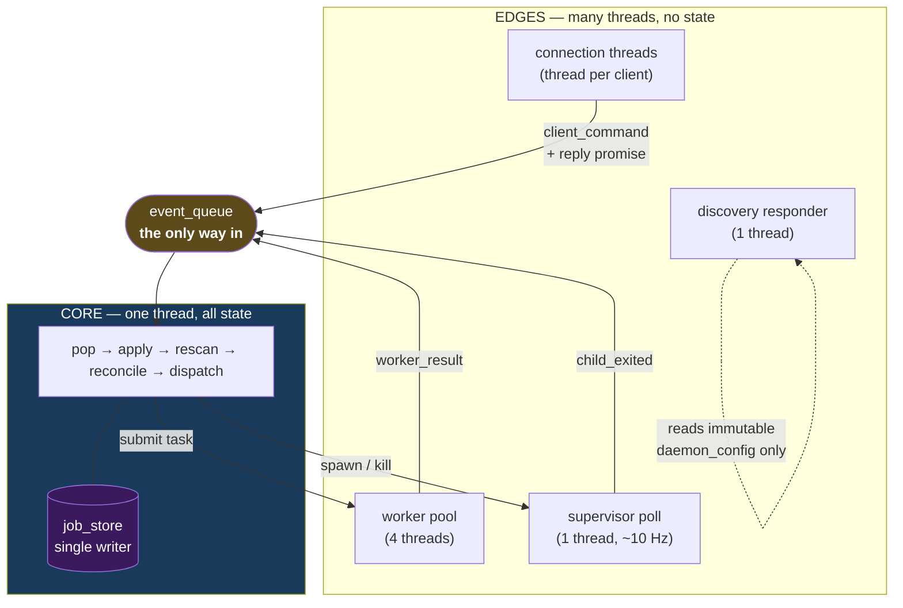

+++
title = "Architecture"
weight = 10
+++

# coastd Architecture

One process. One thread that owns all state. Everything else is an **edge** that
may only push events at it.

That sentence is the whole design, and the rest of this page is what it costs and
what it buys.

## Target tree

`coastd` builds from `coastd/`, added from the root `CMakeLists.txt` via
`add_subdirectory(coastd)`. It produces four targets:



The split that matters is **`coastd_proto` does not depend on `coast_lib`**. It
carries only `daemon/protocol.h` and nlohmann/json. Consequently a frontend that
links `coastd_client` to talk to a daemon pays for *sockets and JSON*, not for the
entire simulator. Both ends of the wire link the same header, so the client and
the server cannot drift out of a compiler-checked contract.

`coastd_core` *does* link `coast_lib`, for four specific things and no more: the
header-only `coast::diag` logging facility, nlohmann/json, the
`diag/progress.h` emitter/parser contract it shares with the child, and
`coast::paths` — so that `coastd` computes a child's checkpoint directory with the
**same resolver the child writes through**, rather than reimplementing the rules
and drifting.

Include paths are worth one note: `coastd/include` is coastd's own header root and
includes are written daemon-rooted (`#include "daemon/types.h"`). The inner
directory is `daemon/`, not `coastd/`, precisely to avoid confusion with
`coast_lib`'s own `include/core/`, which coastd consumes. `coast_lib`'s
`include/` tree carries no coastd headers at all — the dependency is strictly
one-way.

## Subsystems

| Subsystem | File(s) | Responsibility |
|---|---|---|
| **State core** | `core.{h,cpp}` | Sole owner and writer of all job state. Runs the loop; owns the action dispatcher and its in-flight dedup sets. |
| **Reconcile** | `reconcile.{h,cpp}` | Pure `(jobs, reality, config) → actions`. **Is** the state machine. |
| **Job store** | `job_store.{h,cpp}`, `job_json.{h,cpp}` | The durable authoritative model: a git-versioned directory of one file per job. |
| **Reality probe** | `reality_probe.{h,cpp}` | Gathers the fresh, uncached world each pass — worktrees on disk, live children, idle ages. |
| **Worker pool** | `worker_pool.{h,cpp}`, `event_queue.h`, `events.h` | Bounded async workers for finite cancellable tasks. Task → result event. |
| **Builder** | `builder.{h,cpp}` | Resolve a ref, build a per-SHA worktree, GC an idle one. Produces worker tasks. |
| **Supervisor** | `supervisor.{h,cpp}`, `child_proc.{h,cpp}`, `child_cmd.{h,cpp}`, `line_tailer.h` | Owns the one-shot `coast` children: spawn, tail, escalate, reap. |
| **Comms server** | `comms_server.{h,cpp}`, `protocol.h` | The TCP client edge. Thread-per-connection, JSONL. |
| **Discovery** | `discovery_server.{h,cpp}`, `machine_info.{h,cpp}` | UDP probe/respond, plus the static self-description. |
| **Client library** | `client/coastd_client.{h,cpp}` | The thin client side: connect, round-trip, fixed-list hosts, discovery. |
| **Support** | `atomic_write.{h,cpp}`, `proc_util.{h,cpp}`, `types.h`, `net_defaults.h`, `version.h` | Durable writes, process identity, the shared vocabulary. |

## The coupling invariant

> Every edge — worker, connection thread, supervisor poll thread — touches state
> **only** by pushing an `event`. `queue.push(event)` is the sole API boundary
> into the core.



This is a **robustness mechanism, not a performance choice**. The workload is a
handful of jobs and a few events a second; nothing here needs to be fast. What
the single writer buys is that the reliability properties are *provable* rather
than merely tested — there is exactly one place that mutates a job, so "can two
things race on this job?" has a structural answer instead of an empirical one.

Discovery is the one edge that touches nothing: `machine_info` is served straight
from the immutable-after-boot `daemon_config`, with no core hop at all, because it
is a static capability description rather than live state.

## The core loop

`core::run()` (`core.cpp:159`) is deliberately a plain, explicit loop:

```cpp
while (running_.load()) {
    try {
        event e;
        const auto deadline = std::chrono::steady_clock::now() + cfg_.scan_period;
        if (queue_.pop_until(deadline, e)) apply(e);       // fold into the STORE only

        const reality r = rescan(sup_, cfg_);              // ALWAYS fresh, never cached
        for (const action& a : reconcile(store_.active_jobs(), r, cfg_)) dispatch(a);
    } catch (const std::exception& ex) {
        COAST_ERROR("coastd.core", "core loop iteration failed (continuing): {}", ex.what());
    }
}
```

Five properties are load-bearing, and each is there for a named reason:

**Two wakeup sources.** An external event wakes the loop *immediately*; absent
one, the `scan_period` deadline (~1 s) fires as a backstop. So the daemon is
responsive to clients and to child exits, while still re-deriving the world
regularly without anything having to remember to poke it.

**`apply` touches the store, never `reality`.** Events fold durable facts into
job files. The world is then re-derived from scratch. There is no incrementally
maintained view of reality that could drift from the actual filesystem — which is
the class of bug that makes crash recovery hard everywhere else.

**`rescan` is uncached, every pass.** It costs a directory scan and a few
`stat` calls at this workload. Paying it unconditionally is far cheaper than
owning a cache-invalidation problem across crashes.

**Steady clock, not system clock.** `pop_until` uses `steady_clock` because this
is a ~1 Hz backstop, not a wall-clock schedule: a backward NTP step must not
stretch it. (The same reasoning puts the supervisor's SIGTERM grace on a monotonic
clock — an NTP step must not shrink or stretch a kill grace.) `reality.now` is
sampled from the *system* clock, since it is compared against persisted
epoch-millisecond stamps.

**The `try`/`catch` around the whole iteration is not defensive noise.** An
exception escaping a thread's entry function calls `std::terminate`, killing the
process — and under `Restart=on-failure` a persistent condition such as a full
disk would become a crash-loop. Degrading to a logged health error and continuing
means the next iteration re-derives reality and retries. A recurring error becomes
the operator's signal instead of an outage.

## Request/response without a second writer

Clients need synchronous-feeling RPCs, but the core must stay the single writer.
The seam is a closure plus a promise:

```cpp
std::future<job_id> core::submit(job_spec spec) {
    auto prom = std::make_shared<std::promise<job_id>>();
    auto fut  = prom->get_future();
    queue_.push(client_command{
        [spec = std::move(spec), prom](core& c) { prom->set_value(c.do_submit(spec)); },
        "submit"});
    return fut;
}
```

The connection thread pushes the closure and blocks on the future; the core thread
runs it in `apply` and fulfills the promise. The handler gets a blocking call, the
core keeps its invariant, and no state crosses a thread boundary unguarded.

This is also why **shutdown is ordered**. `main()` stops the comms server *first*,
while the core is still alive to drain in-flight futures, and only then stops the
core and joins. Reverse that order and a client blocked in `future::get()` for a
command the dead core will never run would wedge the shutdown. The core thread's
last-resort `catch` closes the event queue for the same reason: closing breaks
pending promises, so a connection waiting on a dead core unblocks instead of
hanging.

## Threads

| Thread | Count | Owns | Blocking behaviour |
|---|---|---|---|
| main | 1 | signal flag, ordered shutdown | polls `g_stop` every 200 ms |
| **core** | 1 | **all job state** | `pop_until(deadline)` — event or ~1 Hz |
| worker pool | `worker_pool_size` (4) | nothing | blocks in `git`/`cmake` subprocesses |
| supervisor poll | 1 | child table | ~10 Hz: tail logs, escalate kills, `waitpid` |
| comms accept | 1 | listen socket | blocks in `accept` |
| connection | 0..`max_connections` (128) | one socket each | blocks in `recv`, and in `future::get()` |
| discovery | 1 | UDP socket | blocks in `recvfrom` |
| job-store committer | 1 | commit queue | blocks on a condition variable |

The **committer thread** is worth singling out. `job_store::commit()` only
enqueues a message and returns, so the core thread never blocks on `git`. A
dedicated thread serializes the actual `git add -A && git commit` — serialized
because two concurrent `git` processes would race on `.git/index.lock`, and
off-the-hot-path because git is an audit trail, not the correctness path. Queued
requests **coalesce**: one `git add -A` captures the whole tree, so a burst of
transitions collapses into a single commit.

See [Threading]({}) for how these sit beside the `coast`
process's own threads — noting that they are in a *different process* and share
nothing but files.

## Dispatch and idempotence

`reconcile` deliberately **over-emits**. It has no memory of what is already in
flight, because giving it one would make it stateful and destroy the property that
makes it testable. Instead, the dispatcher (`core::dispatch`, a
`std::visit` over the action variant) is **idempotent per (kind, key)** and owns
three in-flight sets:

```cpp
std::unordered_set<job_id> resolve_in_flight_;
std::unordered_set<sha_t>  build_in_flight_;
std::unordered_set<sha_t>  gc_in_flight_;
```

An action whose effect is already running is dropped. Builds are additionally
capped at `build_concurrency` (1), so a build gets half the box while running
simulations keep the other half.

The dispatcher is also where several **cross-action safety interlocks** live —
they belong here rather than in `reconcile` because they are about *what is
currently in flight*, which is exactly the state `reconcile` must not have:

| Interlock | Prevents |
|---|---|
| `build_worktree` skipped if `gc_in_flight_` | Building into a directory `gc_task` is deleting → spurious build failure → terminal job failure. |
| `spawn_child` skipped if `gc_in_flight_` | Launching a binary that is being deleted. Next pass sees the tree gone and rebuilds instead. |
| `gc_worktree` skipped if `build_in_flight_` | Deleting a tree a build is actively writing. |
| `spawn_child` skipped if `j->pid != 0` | The **store-side skew guard** — see below. |

### The skew guard

This one is subtle enough to state explicitly, because it is the difference
between correct and catastrophic.

`supervisor::poll_once` erases a child from `live_ids()` the instant it reaps it.
But the `child_exited` event that clears `j->pid` may still be sitting in the
queue behind an unrelated event. In that window **reality says "dead" while the
store still says "running with pid P"**. Spawning there would put a *second* child
on the same run directory — the duplicate-run corruption the whole recovery model
exists to make impossible.

So a nonzero recorded `pid` means "a prior launch is still being accounted for" and
suppresses the spawn. The pending `child_exited` clears it, and the next
`reconcile` decides afresh.

The same reasoning explains an asymmetry in how the store is written. `dispatch`
uses the **non-throwing** `try_put` after a successful spawn, not `put`: the child
is already alive, so an exception unwinding with the pid unpersisted would leave a
later restart unable to detect the orphan — and it would then spawn a second child
on the same run directory. `try_put` always refreshes the in-memory cache and
reports a failed disk write, and the next successful `put` re-persists.

## Error handling

The anchoring rule is assumption **A10** from Discover: *an external-dependency
failure never crashes the daemon.*

| Layer | Policy |
|---|---|
| Edges and workers (`git`, `cmake`, spawn, sockets) | May fail internally; **caught at the boundary** and converted to a `worker_result` or an error reply. No exception crosses into the core. |
| Core (`apply` / `reconcile` / `dispatch`) | Total and exception-safe. `reconcile` is pure. An "impossible" state **quarantines** the job rather than aborting. |
| Store I/O | Split by consequence: a failed **git commit is benign** (retry; the filesystem is truth). A failed **atomic job-file write is serious** → logged, degrade the job, never crash. |

External failures become job states uniformly — a build failure becomes a job in
`failed/`, not a daemon incident. There are two tiers of defense for the genuinely
unexpected: a **poisoned job** (repeated trips, or an uninterpretable
`schema_version`) is moved to `jobs/quarantine/` so it cannot crash-loop the queue;
and a daemon-wide fault is survivable because the recovery model makes a restart
routine — a backstop, not something the design relies on.

## Where to go next

- [Reconcile & Recovery]({}) — the state machine this loop
  drives, and what happens at boot.
- [Persistence & the Child Contract]({}) — what the
  store writes and how a child is actually launched.
- [Protocol & Clients]({}) — the edge this core is fed by.
