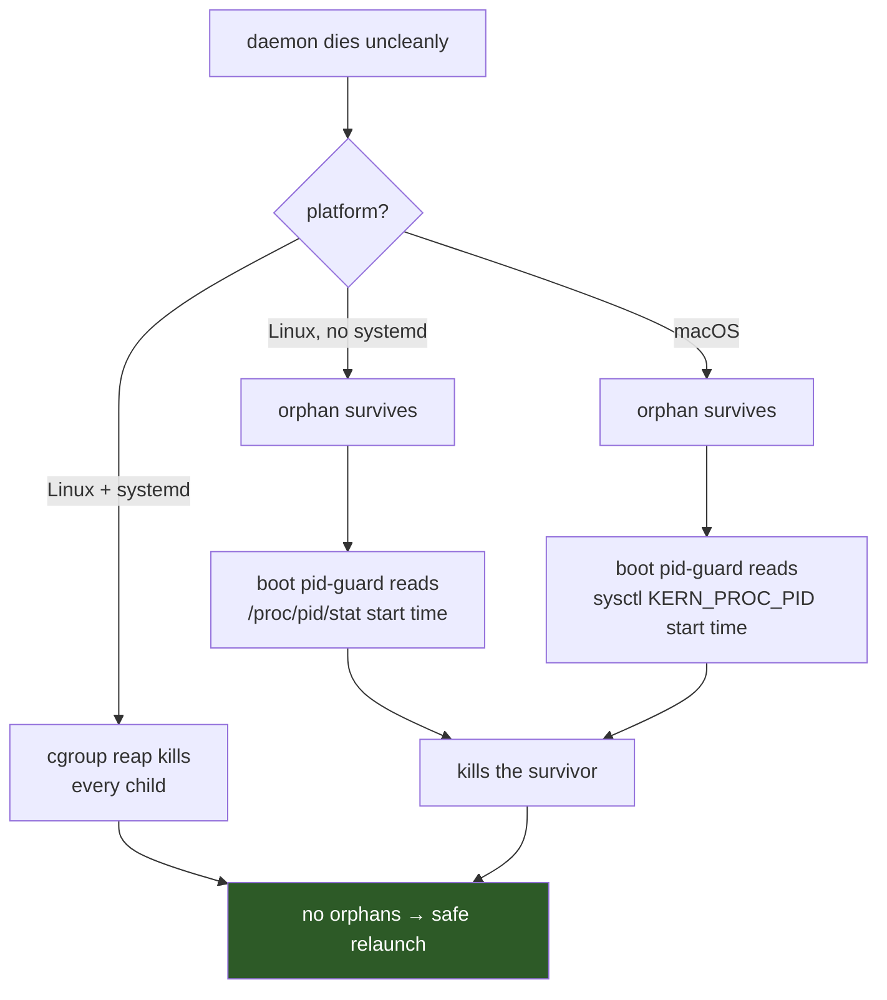

+++
title = "Boundaries"
weight = 50
+++

# Boundaries

What `coastd` does not handle, where it is known to be weak, and what will bite
you. Read this before deploying it anywhere.

The entries below are separated by kind, because they are not the same sort of
thing: some are **deliberate scope exclusions**, some are **accepted trade-offs**,
and some are **genuine gaps** where the design is thinner than it looks.

---

## No authentication at all

{}
**`coastd` binds `INADDR_ANY` and has no authentication whatsoever.**

Submitting a job means asking the daemon to check out an arbitrary git ref, build
it, and execute the result. **Anyone who can reach TCP 51900 has remote code
execution as the daemon user.**
{}

This is an *accepted trade-off*, not an oversight. The Discover stage established
the deployment context explicitly: a small, trusted lab group on a local or VPN
network with SSH access everywhere, where the **network plus git-push access is
the trust boundary**. Building authentication would have been building a second
security model on top of one that already exists.

That reasoning holds exactly as far as the premise does. It is **not acceptable on
any network reachable by untrusted peers.** Mitigations, in order of preference:

1. **Firewall the port to known clients.** The minimum acceptable step.
2. **Bind to loopback and reach it over SSH** (`ssh -L 51900:localhost:51900`).
   Note there is currently *no loopback-bind option*, so this means firewalling
   everything except `lo`.
3. **Run it on an isolated segment or inside a VPN.**

Run it as an unprivileged, dedicated user regardless. A compromise then costs that
user's data and git credentials — bad, but bounded.

The [edge hardening]({}#edge-hardening) (size caps, JSON
depth pre-scan, connection caps, phase timeouts) defends against **accidental and
malformed** input. None of it is access control, and it should never be mistaken
for it.

---

## macOS — supported, but not unattended

Since 2026-11-03 ([ADR-17]({})) the daemon runs on
macOS. Run it by hand there. Unattended operation under launchd is still out of
scope (see below).

R1 (never two `coast` children on one run dir) rests on two legs. On Linux under
systemd, the cgroup reap kills every child with the daemon. Everywhere else the
boot pid-guard is the only leg: it reads the recorded child's start time, and
kills the child if it is still the same process. macOS has no cgroup, so it is in
the second case, the same as Linux run outside systemd.

On macOS the token is `kp_proc.p_starttime` from
`sysctl({CTL_KERN, KERN_PROC, KERN_PROC_PID, pid})`, as microseconds since the
epoch. The same record gives `is_zombie` its answer (`p_stat == SZOMB`). Both live
in `daemon/child_proc.h` / `child_proc.cpp`, the single platform seam.

**The startup gate stays.** On a platform with no start-token source the daemon
still refuses to start, and there is still no override flag. ADR-16 introduced the
gate when macOS was such a platform: `start_token` was always empty there, the
guard never fired, and a child that outlived a daemon crash would have been
relaunched alongside a second one. A warning in a log does not stop that, and a
flag that re-enables a silent-corruption path is that path.

**Still out of scope on macOS:**

- **`--install-service`.** It writes a systemd user unit and exits 1 on macOS.
- **Unattended operation under launchd.** The template at
  `coastd/service/com.coast.coastd.plist` has never been run. launchd does not reap
  the job's process group the way a cgroup kill does, and start at boot, restart
  on failure and credentials for a private remote are unverified there.

{}
**Clients are unaffected.** `coastd_client`, the `coast::coastd` console façade and
the GUI panel are pure TCP and portable — a macOS workstation can drive a daemon on
a Linux host, or one on the same Mac.
{}

---

## The torn-checkpoint finding

Worth stating because the intuitive answer is wrong, and because the code's
*absence* of a check is deliberate.

The Demonstrate stage asked whether a machine dying mid-checkpoint-write could
leave a corrupt checkpoint that auto-resume would silently consume. It could. And
the obvious detector does not work:

| Approach | Catches a real process kill? | Catches power loss? | Verdict |
|---|---|---|---|
| Bare `H5Fopen` liveness check | ❌ **5/5 false-OK** | ❌ | **Reject** — silently resumes from corrupt state |
| Structural `open + visit + read` | ✅ 109/109 truncations, down to 1 byte | ✅ detects | Acceptable fallback |
| **Atomic-durable write in `coast`** | ✅ by construction | ✅ by construction | **Shipped** |

A real `SIGKILL` mid-write produces a **full-length, header-corrupt** HDF5 file
that a bare `H5Fopen` accepts as valid — five times out of five. Any resume-time
"is this file OK?" check built on `H5Fopen` would have been worse than no check,
because it would have looked like protection.

The shipped answer prevents rather than detects: `coast` writes checkpoints with
an atomic-durable `tmp → fsync → rename → fsync(dir)` fence, after which the
newest *complete* checkpoint is intact **by construction**, and `reconcile` needs
no integrity check at all. That is why `job` carries no checkpoint-integrity
state.

The fence is mandatory, not decorative: a bare `mv` is atomic against concurrent
readers but **not durable against power loss** — the ext4-2009
empty-file-after-rename trap. Note also that this correctness property lives in
`coast`, not `coastd`. If that `coast`-side change were ever reverted, `coastd`
would have to adopt the structural check; the two must not be silently decoupled.

Residue: a crash mid-write leaves an un-renamed `.tmp`. Boot recovery sweeps stale
`.tmp` files from both the snapshots directory and the job store.

---

## No resource awareness

`slots` is a **human-set fixed count**. `coastd` does not know how much memory a
job needs, does not measure load, and will happily start `slots` jobs that
collectively OOM the machine.

This is deliberate — the Discover stage ruled resource-aware packing into the
*future* multi-daemon-pool increment, and it is a real operator responsibility, not
a bug to file. Set `slots` conservatively. COAST simulations are CPU-bound and
TBB-parallel internally, so **more slots is not automatically more throughput**;
oversubscribing cores makes every job slower. Start at 1–2 and measure.

---

## Disk: a floor, not a budget

`coastd` measures free space and **stops starting new work** below
`min_free_disk_bytes` (default 2 GiB) — no builds, no launches, while running
children, worktree GC and terminal transitions continue. See
[disk pressure]({}#disk-pressure--gate-the-start-of-work-never-its-finish)
for why exactly those actions and no others.

That is a **floor, not a budget**. It stops the daemon making a bad situation
worse; it does not stop the situation. Two things still grow without a hard bound:

- **Run directories are kept forever.** Nothing prunes them, ever.
- **Per-SHA worktrees** cost roughly **238 MB each** (measured; ~77 MB of that is a
  per-tree wgpu `_deps`). Idle ones are GC'd after `worktree_cooloff`, but only
  when unreferenced.

So the operator still owns retention: prune run directories on a policy you
decide. Each is self-contained, so deleting one is safe as long as its job is
terminal. If you hit the floor, the daemon logs it once — and logs again when it
clears — but it will sit there waiting rather than fail your queue.

---

## Build cost is bounded but not trivial

A clean build of a new SHA measured **~113 s at `-j32`**. The scheduler treats a
first build as a job stage, not an instant — which means a job on a fresh ref sits
in `building` for minutes before it ever reaches the queue.

Build *duration* was explicitly ruled out as a success metric during Discover
("takes as long as it takes"); only worktree and refcount *correctness* is gated.
But it shapes expectations: submitting fifty jobs on a new branch produces one
build and forty-nine jobs waiting on it, because `build_concurrency` is 1.

Cool-off GC (default 6 h) exists precisely so a resubmission against a recent SHA
skips the build entirely.

---

## Datasets and relative paths

The child runs with its working directory set to **the job's run directory**. A
config using relative dataset paths like `./data/mnist/…` therefore will not
resolve — and worktrees created by `coastd` do not contain `data/`, which is
gitignored.

**Use absolute dataset paths in configs you submit.** This is the single most
common cause of a job that builds fine and then fails immediately.

Dataset provisioning itself is out of scope: `coastd` only *advertises* well-known
locations through `machine_info`.

---

## Operational sharp edges

| Edge | Consequence |
|---|---|
| **`steps_target: 0` means unbounded** | A job submitted without a target runs forever. The easiest way to burn a machine for days by accident. |
| **`reorder` overwrites explicit priorities** | It renumbers the pending queue positionally. A submit-time priority does not survive an unrelated reorder. |
| **`term_grace` defaults to 10 s** | A large model whose final checkpoint write exceeds it loses that work on cancel *or* shutdown. Raise it, and keep `TimeoutStopSec` above it. |
| **`checkpoint_interval` larger than a job's realistic run length** | The job makes zero durable progress and is eventually failed with a distinct reason naming the interval. |
| **Editing job files while the daemon runs** | The daemon is the single writer; your edit is overwritten or lost. |
| **Forgetting `loginctl enable-linger`** | A systemd *user* service only runs while that user has a login session. The daemon quietly disappears after logout. |
| **Overriding `KillMode`** | `control-group` **is** the recovery contract. Setting `process` or `mixed` leaves orphans and breaks R1. |
| **Setting `COAST_APP_CONFIG` in the service environment** | It is shadowed by the daemon's explicit `--app-config` and will not take effect. |

---

## Protocol limits

**No push, no subscriptions.** Clients poll `list()` (~2 s). A push/notification
mechanism was explicitly deferred to v2. The upside is that there is no
server-side subscriber state to leak or desync — which is exactly what makes a
client detachable.

**No request-id, so a transport error poisons the connection.** A timed-out reply
is still in flight and the protocol cannot detect the resulting desync, so the
client library closes the socket rather than risk mis-attributing the *previous*
command's reply. Frontends must reconnect.

**`list` returns every job in every bucket.** There is no pagination and no
filter. Fine at lab scale; it grows linearly with the number of jobs ever
submitted, since terminal jobs are never pruned.

---

## Scope exclusions (by design, not gaps)

These will not be fixed, because they were decided against:

| Excluded | Reason |
|---|---|
| Cross-compilation, shipping binaries | Native build on the target is the point. |
| Running uncommitted / dirty code | A committed git ref is the only accepted code identity. |
| Transferring results back to clients | The filesystem is the output surface; retrieval is out-of-band. |
| Live probe-visualization streaming | Removed during Discover; will never exist in this context. |
| Multi-daemon pool, resource-aware packing | A future increment. The design avoids precluding it, and builds nothing toward it. |

---

## What is actually verified

Being precise about the evidence, since "it works" is not a measurement:

| Property | Evidence |
|---|---|
| Scheduling + recovery policy | `test_reconcile.cpp` — pure, table-driven, zero subprocesses |
| Store durability, quarantine | `test_job_store.cpp`, `test_job_json.cpp` |
| Command derivation, resume budget, kill escalation | `test_child_cmd.cpp`, `test_supervisor.cpp`, `test_proc_util.cpp`, `test_child_proc.cpp`, `test_line_tailer.cpp` |
| Worktree creation | `test_builder.cpp` — against this very repository |
| Full lifecycle + boot recovery + crash-loop cap | `test_core_lifecycle.cpp`, `test_child_exit.cpp`, `test_recovery.cpp` |
| Wire protocol, console façade | `test_comms.cpp`, `test_console.cpp` — drive the **real** `coastd` binary |
| Interpreted façade | `tests/unit/console/test_console_repl.cpp` — against a live daemon |
| **End-to-end bit-identity** | `run_real_gate.sh` (ctest `gate.coastd.real_coast`) — a real mnist job *through* `coastd` matches a direct `coast` run bit-for-bit. (A second gate, a child SIGKILLed mid-run and auto-resumed matching an uninterrupted run, was removed 2026-11: its kill window was held only by timing. Auto-resume is not end-to-end bit-checked against real coast any more.) Prerequisites missing → ctest **Skipped** (exit 77), never a silent pass. |
| **Fault matrix + latency** | `test_fault_matrix.cpp` (ctest `fault.coastd.matrix`) — {kill client, kill daemon} × {building, queued, running}, 6/6, against the real binary with real children and a real build; the fake build and child block on release files (`fault_rig.h`), so each fault provably lands in its state. Plus the behaviour behind the latency criteria (visible at once, child death detected, cancel acknowledged and settled). The latency **numbers** are a manual benchmark, `bench_coastd_latency` (2026-11: 1.1 ms / 86 ms / 0.7 ms / 86 ms obedient / 3.2 s = `term_grace` stubborn); first recorded in `design/coastd_fault_matrix_results_2026-07-26.md`. |
| cgroup reap, pid-guard, worktree isolation, tail/parse | The four Demonstrate spikes (design-stage experiments, not kept in the repository) |

And what is **not**:

- The **GUI panel's runtime behaviour** — compile-verified only; exercising it
  needs an installed, running daemon, and that test was deferred by explicit
  decision.
- **Unattended operation on macOS.** The test suite, the fault matrix included,
  passes there (ADR-17), but launchd supervision has never been run.
- **Power-loss durability** of the checkpoint fence — the argument rests on
  settled POSIX `rename`/`fsync` semantics, and the power-loss leg was unpluggable
  on the development host. Stated as reasoning, not as measurement.
