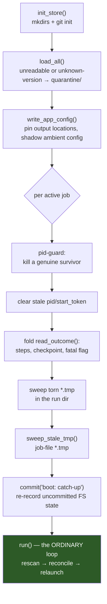

+++
title = "Reconcile & Recovery"
weight = 20
+++

# Reconcile & Recovery

```cpp
std::vector<action> reconcile(std::span<const job>  jobs,
                              const reality&        r,
                              const daemon_config&  cfg);
```

Pure. No I/O, no globals, **no clock beyond `reality.now`**. The entire
scheduling *and* recovery policy is a deterministic function of three explicit
inputs.

This page is the centre of the design. Everything else in `coastd` exists to feed
this function accurate inputs and to faithfully execute its outputs.

## What purity buys

Two things, and the second is the one that matters.

**It is testable with zero subprocesses.** The whole policy — slot caps, FIFO
ordering, crash-loop capping, worktree GC, cancel semantics, boot resume — is
table-driven unit-testable. `tests/unit/coastd/test_reconcile.cpp` needs no
daemon, no sockets, no `git`, no `coast`. A reliability property you can assert in
a microsecond gets asserted; one that needs a five-minute fault-injection rig gets
asserted once and then rots.

**Recovery is not a separate code path.** Boot does: load the store, probe
reality, call `reconcile`. Steady state does: apply an event, probe reality, call
`reconcile`. *Same function.* There is no recovery code to rot, because there is
no recovery code — recovery is the ordinary path applied to an unusual starting
state.

This is the single biggest robustness lever in the project. Crash recovery
normally fails in production precisely because it is rare code exercised only by
rare events. Here it runs roughly once per second on every healthy daemon.

## Unordered, reconverging actions

Actions have **no ordering constraints among themselves**. Each depends only on
`reality`, never on another action in the same pass.

The consequence is the property that makes partial failure survivable: if the
daemon dies halfway through dispatching a batch, **nothing is inconsistent**. The
next `reconcile` looks at wherever reality actually got to and re-derives what to
do from there. There is no "we were in the middle of a transition" state, because
there are no transitions — only a repeatedly-recomputed answer to "given the world
as it is, what should happen next?"

This is why `reconcile` may safely emit an action whose effect is already in
flight (a build already running, say). It has no idea, and it must not: the
[dispatcher's idempotence]({}#dispatch-and-idempotence)
absorbs the over-emission.

## Derived, never stored

The discipline that makes the above work:

> Everything a crash could desync is **derived**, never stored.

| Derived each pass | Never persisted because |
|---|---|
| Slot availability | It is `count(alive children)` — a stored counter would drift on any unclean exit. |
| SHA refcount | It is `count(non-terminal jobs holding that SHA)`. A stored count desyncing is exactly the cross-batch contamination bug (A9). |
| Worktree presence | The directory either exists or does not. |
| Build readiness | The `.coastd-ready` sentinel either exists or does not. |
| Worktree idle age | Filesystem `mtime`. |
| Relaunch eligibility | `reality.now` compared against the job's `last_launch_ms`. |

The job file stores only what genuinely cannot be re-derived: identity, the frozen
SHA, cumulative steps, the failure/cancel intent, and the counters that record
*history* (`launch_failures`, `no_checkpoint_launches`) rather than current state.

Note what is deliberately absent: **there is no checkpoint-integrity state**.
`coast` writes checkpoints atomic-durably (`tmp → fsync → rename → fsync(dir)`),
so the newest *complete* checkpoint is intact by construction. Recovery simply
picks the newest by step and sweeps stale `.tmp` files. The structural HDF5
validity check that the Demonstrate stage built and validated was the fallback for
an *unmodified* `coast`, and is not shipped — see
[Boundaries]({}#the-torn-checkpoint-finding).

## The rule table

Applied per active job, **first match wins** (`reconcile.cpp:56`):

| Condition | Action |
|---|---|
| `failure_reason` set, child alive | `kill_child{SIGKILL}` (defensive) |
| `failure_reason` set, child dead | `move_bucket{failed}` |
| `cancel_requested`, child alive | `kill_child{SIGTERM}` |
| `cancel_requested`, child dead | `move_bucket{cancelled}` |
| `ref_sha` empty | `resolve_ref` |
| child dead, `steps_target > 0` and `steps_done >= steps_target` | `move_bucket{done}` |
| SHA not in `builds_ready`, `disk_pressure` | *(hold — no strike, it just waits)* |
| SHA not in `builds_ready`, `worktrees_unreadable` | *(hold — an unknown world is not an empty one)* |
| SHA not in `builds_ready` | `build_worktree` |
| build ready, child alive | *(running — no action)* |
| build ready, child dead, within relaunch backoff | *(skip this pass)* |
| build ready, child dead, `disk_pressure` | *(hold — pressure gates the START of work, never its continuation)* |
| build ready, child dead, work remains | → spawn candidate |

{}
**Failure is checked *before* cancel, and the order is deliberate.** If a terminal
failure was already recorded — a build failure, a crash-loop trip, poison — that is
the *true* terminal cause. Letting a subsequent cancel relabel it `cancelled/`
would file the `failure_reason` where no operator will ever look for it.

This interacts with a real guard in `on_child_exited`, which charges no crash-loop
strike when a child died because of a pending cancel — precisely because a bogus
strike could set a "crash-loop" `failure_reason` and, failure being checked first,
misfile a clean cancellation as a failure.

(The rule-table comment in `reconcile.h` used to list cancel first, contradicting
the code it documents. Fixed 2026-07-26 — the implementation was always correct.)
{}

{}
**Completion is decided *before* build readiness**, alongside failure and cancel —
it is a terminal outcome, not a scheduling one. Filing a finished job must not
depend on having a worktree to run it in; those are unrelated facts.

Below the build gate (where it once sat) a job whose steps were done but whose
worktree was gone — GC'd after a crash, or `worktrees_root` on tmpfs across a
reboot, with `steps_done` folded back from the manifest at boot — emitted
`build_worktree`: a ~238 MB tree and a full cmake build, minutes of CPU, purely so
a job that had already finished could be moved to `done/`. If that build then
failed `max_build_failures` times, the core stamped a `failure_reason` on every job
on the SHA — filing a *successfully completed* job to `failed/`. Under disk
pressure it produced no action at all and the job sat in `active/` indefinitely.

`steps_target == 0` is unbounded and never satisfies the rule; `!running` is
required because a live child still owns the run dir, so the terminal move happens
on the pass after it exits.
{}

Then two cross-job policies run over the whole set.

### Slot budget — the scheduler

```cpp
int budget = cfg.slots - r.running_count;
```

Candidates sort by **priority descending, then `submitted_at` ascending (FIFO),
then id**. The final `id` tiebreak is not decoration: `submitted_at` has
one-second granularity, so two jobs submitted in the same second would otherwise
have no total order, and the schedule could differ between passes. The comparator
is one named function (`job_queue_less` in `types.h`), shared by this scheduler,
both reorder forms in `core`, and `job_store`'s display order — so a job's listed
position, a reorder's intent, and the scheduler's behaviour cannot disagree.

The top `budget` candidates get `spawn_child`. The action carries **only the job
id** — the supervisor derives the command line, including whether this is a fresh
run or a resume.

### Worktree GC — cool-off hygiene

A SHA whose refcount is 0 and whose worktree `mtime` is older than
`worktree_cooloff` (default 6 h) gets `gc_worktree`.

Refcount 0 makes a worktree *idle but kept*, not garbage. A new job for the same
SHA arriving during cool-off **reuses the tree and skips the build entirely** —
which, at ~113 s and ~238 MB per clean build (measured during Demonstrate), is the
difference between a resubmission being instant and being a two-minute stall. GC is
hygiene, never on the hot path.

An unknown idle age is treated conservatively as "keep".

### Disk pressure — gate the *start* of work, never its finish

`rescan` measures free space on `runs_root`, `worktrees_root` and `state_root`
(`statvfs`, ~250 ns per root — measured) and sets `reality.disk_pressure` when the
minimum falls below `cfg.min_free_disk_bytes` (default 2 GiB, `0` disables).
Reconcile then suppresses exactly two actions: `build_worktree` and `spawn_child`.

Which actions stay enabled is the whole design:

| Under pressure | Why |
|---|---|
| `build_worktree` **suppressed** | The largest single allocation the daemon makes (~238 MB), and it can fail *halfway*, leaving a tree that is neither usable nor obviously garbage. |
| `spawn_child` **suppressed** | Starting a run commits to a stream of checkpoints there is no room for. The job waits, with no strike and no `failure_reason`. |
| a running child **untouched** | Killing it discards the steps since its last checkpoint and frees nothing already on disk. Its next checkpoint is small next to a build. |
| `gc_worktree` **still emitted** | It is the only action that gives space *back*. Suppressing it would remove the daemon's sole self-relief. |
| terminal `move_bucket` **still emitted** | Finishing, failing and cancelling jobs must still settle — they only shrink the active set. |

The condition is reported on its **edges** (`core::log_disk_pressure_edge`), not
every pass: reality is recomputed from scratch each loop and reconcile is pure, so
neither can remember it already complained, and a ~1 Hz repeat is how a real
signal becomes noise an operator filters out.

## Backoff — the same policy, two consumers

```cpp
std::uint64_t backoff_ms(int failures, const daemon_config& cfg);
// base * 2^(failures-1), clamped to relaunch_backoff_max; shift capped at 30.
```

Without backoff, a job that fails to launch retries every `scan_period` (~1 s), so
a purely **transient** fault — `fork` returning `EAGAIN` under memory pressure, a
briefly unavailable dataset mount, a GC/build race — burns all
`max_launch_failures` strikes in about five seconds and terminally fails a job
that would have succeeded moments later.

The same function spaces **build** retries in the dispatcher, for the same reason:
a network blip during a submodule fetch or a CMake `FetchContent` download must not
consume all `max_build_failures` in seconds.

Backoff stays pure: `reconcile` compares `reality.now` to the job's persisted
`last_launch_ms`. It is a derived scheduling decision, never a live timer.

## Three failure counters, three different meanings

A job can stop making progress for reasons that look identical from outside and
are not. Collapsing them into one counter would mislabel working jobs as broken.

| Counter | Increments when | Terminal reason | Cleared by |
|---|---|---|---|
| `launch_failures` | A launch achieved **nothing at all** — immediate segfault, or `posix_spawn` itself failed | `"crash-loop: N consecutive launches with no forward progress"` | any durable progress |
| `no_checkpoint_launches` | The child **ran real steps** (seen on the log tail) but died before its first checkpoint | `"ran real steps but checkpointed nothing in N consecutive launches (checkpoint_interval=… too large?)"` | any durable progress |
| `build_failures_` (in-memory, per SHA) | A build task failed | `"build failed … (after N attempts)"` on every job holding that SHA | a successful build |

The middle one is the interesting case. A job repeatedly interrupted before
`checkpoint_interval` makes **zero durable progress** and would resume from the
same base forever — a genuine liveness bug. But it is *not* a crash-loop, and
counting it as one would mark a perfectly healthy job `failed`. So it gets its own
counter and a terminal message that names the actual cause, pointing the operator
at the knob to turn.

Distinguishing "ran real steps" from "achieved nothing" is why `child_exited`
carries `tailed_step` alongside the durable `steps_done`: a step observed on the
log tail beyond the resume base is genuine compute even if no checkpoint recorded
it. That decouples the crash-loop guard from `checkpoint_interval` entirely.

Note that `build_failures_` is deliberately **not persisted**. A daemon restart
re-attempts fresh; a genuinely broken build simply re-fails fast and re-caps. What
*is* durable is the `failure_reason` the cap stamps onto the jobs.

A **spawn failure** (`posix_spawn` returned an error — binary missing, `EPERM`,
resource exhaustion) is charged to `launch_failures` explicitly, because no child
was created and therefore **no `child_exited` will ever arrive** to advance the
cap. Without that, the job would be re-selected every pass forever, silently
starving the queue.

## R1 — the recovery model

The decision that makes crash recovery tractable:

> **Children die with the daemon.** Therefore there are no live orphans, ever.
> Every daemon restart — crash or clean — relaunches each interrupted job from its
> last good checkpoint.

On Linux this is not something `coastd` implements; it is systemd's stock
`KillMode=control-group` behaviour, which the unit deliberately **does not
override**. The Demonstrate stage verified it directly: `kill -9` on the daemon's
MainPID reaped the child 3/3, and switching to `KillMode=process` reproduced the
orphan 3/3.

The design principle behind this — *prefer system defaults; fighting them is
brittle* — is doing real work here. `coastd` gets its most important safety
property by **not writing code**.

What R1 buys: the duplicate-run nightmare — two children writing the same run
directory, silently corrupting output — is **impossible by construction**. A dead
child cannot be duplicated. There is nothing to detect, no reattach protocol, no
liveness marker files, no PID handshake.

What it costs: up to one checkpoint interval of recomputed work per interruption.
That is pure efficiency, and efficiency is an explicit non-goal.

### The pid duplicate-guard

R1 rests on an assumption — "systemd always reaps" — and *"systemd always
behaves" is an assumption bound to fail eventually*: during development the daemon
runs outside systemd, and macOS has no cgroup at all. So `recover_at_boot` carries
a fallback:

```cpp
if (j.pid > 0 && !j.start_token.empty() &&
    is_same_process(static_cast<pid_t>(j.pid), j.start_token)) {
    COAST_WARN(...);
    send_signal(static_cast<pid_t>(j.pid), SIGKILL);
}
```

`start_token` is the process start-time field from `/proc/<pid>/stat`, which makes
the check **recycle-safe**: a reused PID belonging to some unrelated process has a
different start time and is correctly rejected. Demonstrate validated this 5/5
against both recycled and dead PIDs.

Under systemd the child is already dead and this is a no-op. Off systemd it kills
the survivor before relaunching. Note the survivor was reparented away, so
`coastd` can only *signal* it — never `waitpid` it.

{}
**Platforms.** On macOS the start time comes from `sysctl(KERN_PROC_PID)` instead of
`/proc/<pid>/stat` (ADR-17). On a platform with neither, the guard could not fire,
so the daemon refuses to start there. See
[Boundaries]({}#macos--supported-but-not-unattended).
{}

### What boot actually does

Everything recovery needs beyond the steady-state path is small, which is the
point:



The last step is the whole argument: after a handful of hygiene operations, boot
hands off to the **same loop that was already running**, and relaunching every
interrupted job falls out of the ordinary rules.

The `read_outcome` fold at step G closes a real gap. A daemon crash *between* a
child's clean exit and its `child_exited` event being applied leaves the job file
lagging. Re-deriving from the run manifest plus the newest checkpoint — the same
source the exit path uses — means:

- A job that actually **finished** is recognized and moved to `done/` instead of
  being rerun from scratch. This matters most for a bounded job with
  `steps_target < checkpoint_interval`, which writes no periodic checkpoint at
  all: without the fold, the spawn dispatcher (which only catches up from the
  snapshots directory) would restart it from zero.
- A **fatal** exit is filed to `failed/` instead of being resumed. The manifest's
  fatal flag is the only record of it, and it would otherwise be dropped with the
  lost event.

Because the manifest is deleted before every launch, a present manifest always
describes *this* job's last clean or fatal exit. A SIGKILLed child writes none.

### One more interlock at spawn

The dispatcher reconciles the store's step count against on-disk truth *before*
deciding to launch:

```cpp
if (auto ck = newest_checkpoint(*j); ck && ck->step > j->steps_done) { … }
if (j->steps_target > 0 && j->steps_done >= j->steps_target) return;
```

Without this, a daemon crash between a final checkpoint and its `child_exited`
leaves `steps_done` lagging and the resume computes `remaining = 0` — a step
budget that cannot be expressed. `coast` requires an explicit run length (`-n`
with a count ≥ 1, or `--unlimited`), so `-n 0` is a **parse error**: the relaunch
would fail immediately and repeatedly rather than run. `plan_launch` clamps such
a case to `-n 1` and logs it as the logic error it is; an unbounded job
(`steps_target == 0`) is the separate case and says `--unlimited` instead, never
`-n`.

{}
`-n 0` used to mean "run forever", which made this the more dangerous failure —
a lagging counter turned into an *unbounded run*. Since the explicit-run-length
change on `refactor/headless-build` the same bug degrades to a failed launch. The
guard stays: a crash-looping relaunch is still worth preventing.
{}

## Testing this layer

| Test | Covers |
|---|---|
| `test_reconcile.cpp` | The rule table, slot cap, FIFO+priority ordering, GC cool-off, backoff — all pure, no subprocesses |
| `test_recovery.cpp` | Boot orphan detection, the pid+start-token guard, crash-loop capping |
| `test_core_lifecycle.cpp` | Full submit → resolve → build → spawn → exit → terminal against a fake `coast` |
| `test_child_exit.cpp` | The `on_child_exited` folds, including the terminal-bucket and cancel guards (via a `friend` test seam, valid only while the loop is stopped) |
| `run_real_gate.sh` | A genuine mnist job through `coastd`, asserting the final state is bit-identical to a direct `coast` run |

The `friend struct core_test_access` seam exists because the event-ordering folds
in `on_child_exited` are unreachable through the public RPC surface without racing
a real child against the loop. It is declared in the header and **defined only by
the test TU** — production code never names it.
