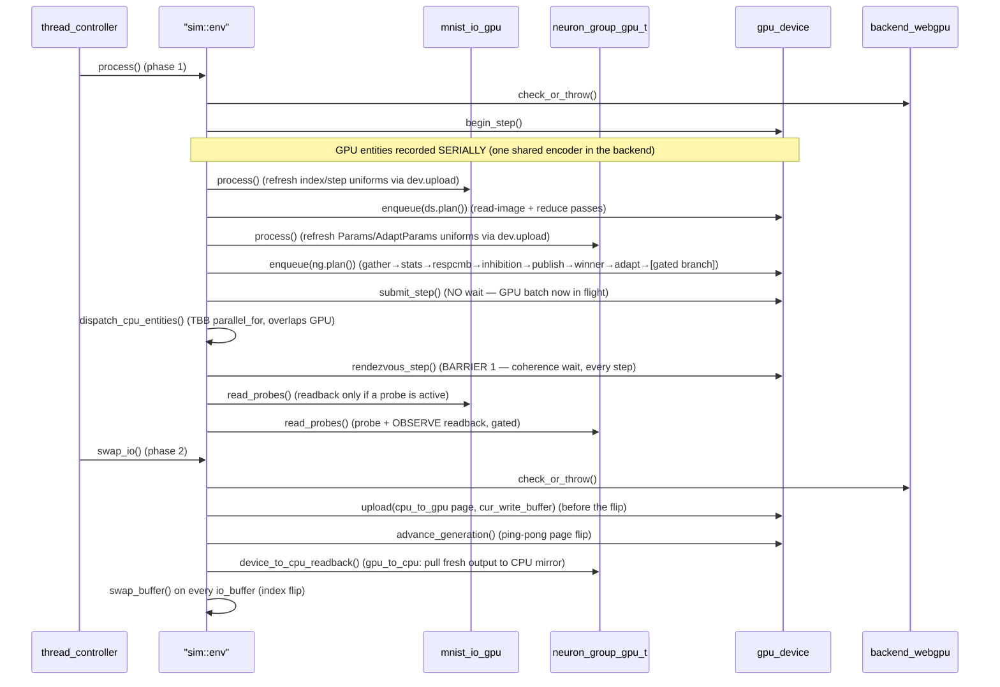

+++
title = "GPU Dispatch"
weight = 25
+++

# GPU Dispatch — A Heterogeneous Step in Detail

This page traces a single simulation step when GPU entities are present. It refines the CPU-only picture in [Simulation Loop]({}); read [Heterogeneous Execution]({}) first for the mechanism.

Since the *gpu-abstraction-layer* refactor the simulation core no longer touches WebGPU directly. `env`, the GPU entities, and the `io_buffer` base describe their per-step work as a backend-agnostic **`step_plan`** and drive it through the virtual **`gpu_device`** façade, which exposes only opaque handles (`buffer_id` / `kernel_id` / `plan_id`). A single backend translation unit — `backend_webgpu.cpp` — is the only code that includes `<webgpu/webgpu.h>`. See [core/gpu]({}) for the façade and backend.

Each GPU entity builds its `step_plan` **once** at construction (`build_step_plan(dev)`); the plan is **static** across steps (the §13.4 audit confirmed per-step CPU→GPU traffic is uniforms-only, with the dataset GPU-resident). Per-step variation enters through exactly two channels, neither of which mutates the plan: small **uniforms** refreshed via `gpu_device::upload()`, and the **ping-pong generation** advanced once per step at the swap. Each step the backend re-records a throwaway command encoder from the cached plan (a `WGPUCommandBuffer` is single-use), so the recorded command stream is identical to the pre-refactor `record()` path.

There is **one mandatory coherence wait per step**, in `process()` (`rendezvous_step()`); it does not block immediately after submit, so the CPU entities run while the GPU batch is in flight. `swap_io()` then moves any cross-device data and flips the generation.

## A Worked Example

Consider a fully-GPU pipeline plus a CPU logger watching the output:

```
mnist_io_gpu ───io_buffer(gpu)───▶ neuron_group_gpu_t ───io_buffer(gpu_to_cpu)───▶ buffer_logger (CPU)
   (GPU)                                 (GPU)
```



## Phase 1 — `process()`: host bookkeeping + plan enqueue

GPU entities are handled **serially** (one shared command encoder is not safe for concurrent recording): for each, `process()` advances host-side counters and refreshes its small uniform buffers through `gpu_device::upload()` (the backend orders the write ahead of the next submit), then `enqueue(plan())` appends that entity's cached `step_plan` — its copies and compute passes in plan order — onto the step's encoder. `submit_step()` finishes and submits the batch with **one** queue submit that does **not** wait — so the GPU drains this batch while the **CPU** entities run concurrently via `dispatch_cpu_entities()` (TBB `parallel_for`). Only then does `rendezvous_step()` block until the kernels complete (this cycle's backend realizes it as `wgpuDevicePoll(wait)`), after which `read_probes()` fans probe/OBSERVE values back — the GPU→CPU readback inside it happens only when something is actually observing (see [hd_ngm3]({})).

`rendezvous_step()` is **mandatory and unconditional every step** (BARRIER 1). It makes no data-flow assumptions: a GPU output may feed a CPU entity or a cross-device buffer and the dispatcher cannot know, so it always synchronizes. The contract is specified as *coherence*, not literally a device drain, so a future backend could realize it with an event — but it remains a full per-step synchronization; nothing is deferred across steps.

wgpu inserts the necessary barriers between passes whose storage-buffer reads/writes depend on each other, so the recorded sequence executes correctly in queue order without explicit synchronization.

### The gated branch pass

The branch kernel — which used to be appended conditionally on the host (`if (step % branch_interval == 0)`) — is now a **permanent, always-dispatched pass** in the static plan, gated inside the kernel on a per-step uniform: on a non-branch step it early-outs before any buffer write, so it is numerically inert. This keeps the plan structurally static (no host-side conditional append) while preserving byte-identical output on non-branch steps.

## Phase 2 — `swap_io()`: cross-device movement, then swap

This is where data crosses the device boundary. The base `io_buffer` carries the agnostic identity of its GPU page (`gpu_page_id()`, `gpu_topology()`, `gpu_backed()`), registered once at build time via `gpu_register()`; `swap_io()` drives the movement through the device:

1. **cpu→gpu** buffers (`topology::cpu_to_gpu`): `gpu_device::upload(page_id, cur_write_buffer())` stages the just-written CPU page into the device **write** page **before** the generation flip (so the GPU reader sees it next step).
2. **`advance_generation()`** — the device flips the ping-pong generation by one opaque tick; a `ping_pong` `buffer_id` resolves to its other physical page from here on. This is the device-side page flip that carries the one-step lag.
3. **gpu→cpu** buffers (`topology::gpu_to_cpu`): `device_to_cpu_readback()` pulls this step's fresh device output (now on the read side, post-flip) into the CPU read mirror.
4. **`swap_buffer()`** flips `write_idx`/`read_idx` on every `io_buffer` — a pure index operation that *publishes* the freshly produced page to readers for the next step.

`gpu_to_gpu` and CPU-only buffers need no transfer here — the generation flip (resp. the index flip) alone carries the one-step lag. Because all movement precedes the swap, the **one-step latency** invariant holds across the device boundary exactly as it does for CPU-only buffers.

## The Two Barriers

The step contract is two global barriers, both mandatory:

- **BARRIER 1** — every entity has finished before the swap. On the GPU side this is `rendezvous_step()`'s coherence wait, joined with the CPU dispatch.
- **BARRIER 2** — every buffer has swapped before the next step. This is enforced by the serial sim loop (`swap_io()` returns before the next `process()`) plus the blocking nature of any `gpu_to_cpu` readback. The `gpu_device` façade does not weaken either.

## What This Costs

There is one mandatory coherence round-trip per step (`rendezvous_step()`); it now overlaps CPU-entity compute with the in-flight GPU batch (the submit no longer blocks immediately), so on a graph with substantial concurrent CPU work the CPU cost is hidden under the GPU batch. The overlap is latent on entity-sparse graphs (one dominant entity leaves little CPU work to hide). Pre-building the per-generation bind groups once at `build_plan()` (instead of rebuilding a bind group every step) removed the former per-step bind-group churn — a measured GPU-throughput improvement at no behavioral cost. On unified-memory hardware (Strix Halo) the cross-device "copies" are cheap, but the framework does not assume that and does not benchmark it; the structural correctness is what matters here. See [Threading]({}) for how the readbacks for visualization ride the post-swap barrier.
