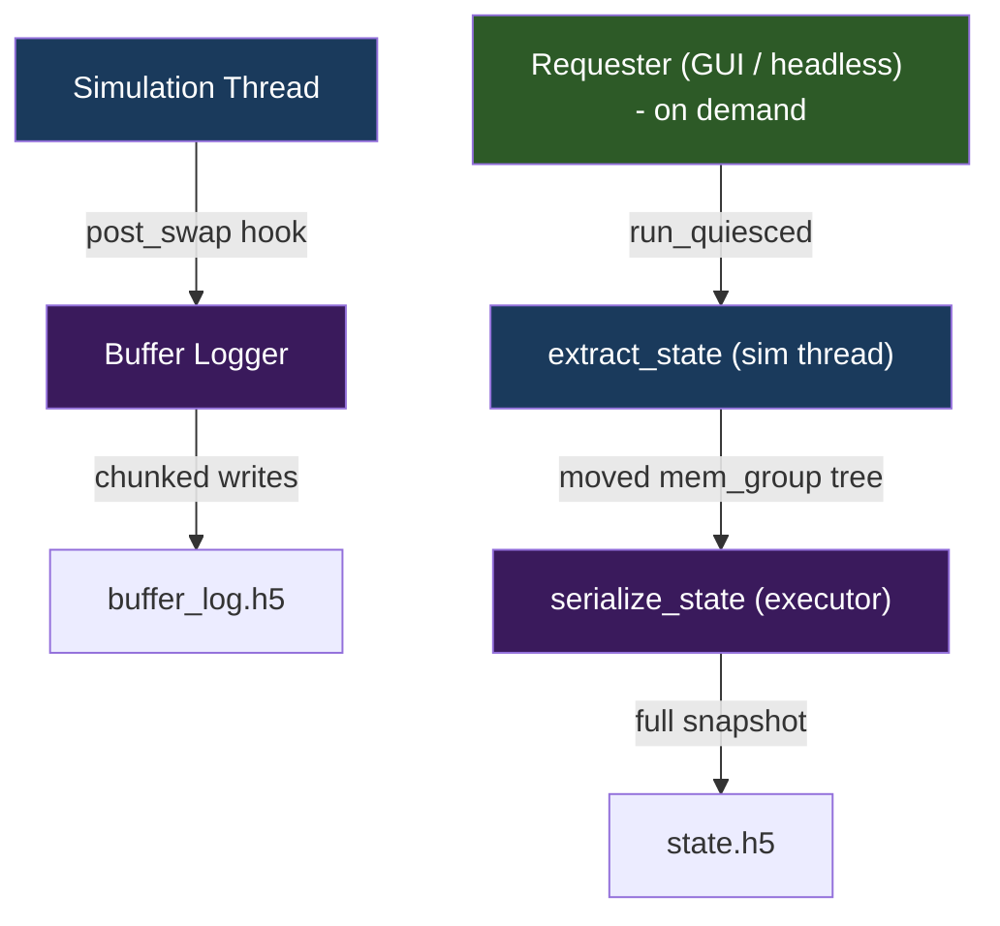

+++
title = "Logging Pipeline"
weight = 40
+++

# Logging Pipeline

How simulation data is persisted to disk.

## Two Logging Paths

Per-probe CSV output (`csv_file_observer`) is a probe observer, not a logger; see the [probe pipeline]({}).



## Buffer Logging

**Runs on**: Simulation thread (via post_swap hook)

**Flow**:
1. `start()` registers a `post_swap_hook` with `sim_env`
2. After each `swap_io()`, the hook fires `capture_frame(step)` with the simulation step (`probe::get_current_step()`); `@start_step` is the first logged frame's step, written with the first batch
3. Copies ALL buffer read data and statistics into a `frame_data` struct
4. Accumulates frames in `frame_buffer_`
5. When `chunk_size` frames accumulate (default 1000):
   - Extends all HDF5 datasets by `chunk_size`
   - Writes via hyperslab selection (no flush: HDF5 may keep the chunks in its cache until stop)
   - Checks every result; the first failure trips the sticky `write_ok()` flag and no later batch is written (#203)

6. Stop (`logging_manager::stop_buffer_logging(ctrl)`): the hook is detached inside `run_quiesced`, then the remaining frames are written, the file flushed and closed on the caller's thread with no hook running. A failed write, flush or close makes the stop return an error; the headless run then exits 1

**HDF5 schema**:
```
/metadata/
    @type, @schema_version, @start_step, @config, @created
/metadata/topology/
    buffer_ids [N], buffer_sizes [N], buffer_names [N]
    connectivity [E x 2], vis_hints [N x 3]
/steps/
    step_numbers [T], timestamps [T]
    buffers/<id>/data [T x S]     (float32, chunked, gzip)
```

## State Persistence

**Runs on**: split across the sim thread and the HDF5 executor; the requester (GUI or headless main thread) only orchestrates. The sim does **not** need to be paused — the sim-thread halves run inside `sim_thread_controller::run_quiesced` tasks at the post-swap boundary, which works while stepping and while paused alike (see [Threading]({})).

### Save
1. **Extract** (sim thread, `run_quiesced`): `extract_state` walks every io_buffer (`snapshot()` reads the read page; GPU readback happens here, on the queue-owning thread) and every entity (`entity.save_state(mem_writer)`) into an in-memory `mem_group` tree. The sim is blocked only for this fast extraction.
   - Datasets save: `cur_epoch`, `cur_idx`, `ci_cnt`
   - Neuron groups save: group params, neuron state, dendrite state (synapse arrays, segment data)
2. **Serialize** (executor, async): `serialize_state` adds the save-event metadata (config JSON, timestamp; extraction already wrote the format version and step count), takes ownership of the tree, and replays it through `hdf5_state_writer` into the file. The file is closed *before* the returned future resolves, so a `file_size()` after `.get()` sees the final size.
3. The requester decides whether to await the future: headless **must** (the run manifest records savestate sizes); the GUI may treat it as fire-and-forget.

### Load
1. **Parse** (executor, blocking): `parse_state` checks the format version (refusing a missing, malformed or newer one; see [logging]({})) and reads the whole file into a `mem_group` tree plus metadata (step count, config).
2. **Apply** (sim thread, `run_quiesced`): `apply_state` restores each io_buffer's **read page directly** via `restore()` — no swap — and calls `entity.load_state(mem_reader)`; the same task then calls `set_step_count(restored_step)` so the counter changes at the same quiescent boundary. If an entity's `load_state` throws (e.g. a checkpoint that does not fit the group), what was applied before it stays applied: the same task then halts the controller (`halt()`, fault kind `partial_load`, see [Threading]({}) §6) before another step can run, leaves the step counter as it was, and the load returns a failed result.
3. Return merged result with any warnings (size mismatches degrade to warnings).

`logging_manager::load_state(ctrl, path)` packages steps 1–2 for the runtime callers (logging window, snapshot resume). An entity that refuses the checkpoint (another shape, or corrupt) throws inside step 2; `load_state` turns that into a failed result for its callers. Whatever step 2 applied before the throw stays applied, and the step counter is not set (see [logging]({})).

### Startup load exemption

`build_env`'s `--resume` / `--load-state` uses `logging_manager::load_state_startup`, which parses **and** applies inline on the executor with no `run_quiesced`. This is safe only at construction: the sim thread is parked and has never stepped, so the main thread is the sole user of the wgpu queue and the sole writer of sim state. A load at any later time must go through the split path (`design/quiesced-state-access.md` §5.2).

### Auto-Checkpoint

The `logging_window` implements automatic checkpointing with the same
deterministic cadence as the headless `--checkpoint` path:
- Enabled via checkbox + interval (minimum 100 steps).
- A **sim-thread `post_swap` hook** tests the exact completed step count once per
  step and fires at exactly every `interval` steps (relative to when the checkbox
  was enabled), independent of GUI frame rate. The previous implementation polled
  the step count each GUI frame (`step >= last + interval`), which overshot by up
  to a frame and silently coarsened any interval finer than the frame period.
- Extraction runs inline on the sim thread; the HDF5 write is submitted async to
  the executor and its result is reaped (non-blocking) on the GUI thread for the
  status line. The hook body is wrapped in `try/catch`: a throw that left the
  hook would halt the run as a fault (`do_step()`'s backstop catch, #198), and a
  failed checkpoint should only be skipped.
- Saves to `<resolved snapshot dir>/<config>_YYYYMMDD_HHMMSS_<step>.h5`, where the
  snapshot dir is the config's `snapshot_dir` leaf resolved under `config_base`
  (default `<config_dir>/<config>/snapshots/`).

This is distinct from `gui_manager`'s **auto-save on pause**, which is event-driven
(fires once on a running→paused transition), not interval-based. It skips the
paused mode a halt forces: a halted env may be faulted or partly loaded, and a
snapshot of it would be what the resume dialog offers next.

### Snapshot Resume

On config load, `gui_manager` checks for existing snapshots:
- Scans `<snapshot_dir>/` for matching `<config_stem>_*.h5`
- If found, prompts "Resume from Snapshot?" / "Start Fresh"
- Resume loads the state and restores the step counter

{}
**Path resolution.** The config's `snapshot_dir` is an output *leaf* resolved
under the application config's `config_base` (default `<config_dir>/<config>/`), so
snapshots land next to the config, isolated per config — `configs/mnist.json` →
`configs/mnist/snapshots/`. An **absolute** `snapshot_dir` wins outright (bypasses
`config_base`, fixed regardless of CWD); an empty leaf defers to the app-config
default. The **write** path (headless `--checkpoint`, GUI auto-save /
auto-checkpoint) and the **resume/read** path go through the *same* resolver, so
they always agree. See [Application config]({})
and [json_cfg]({}).
{}
