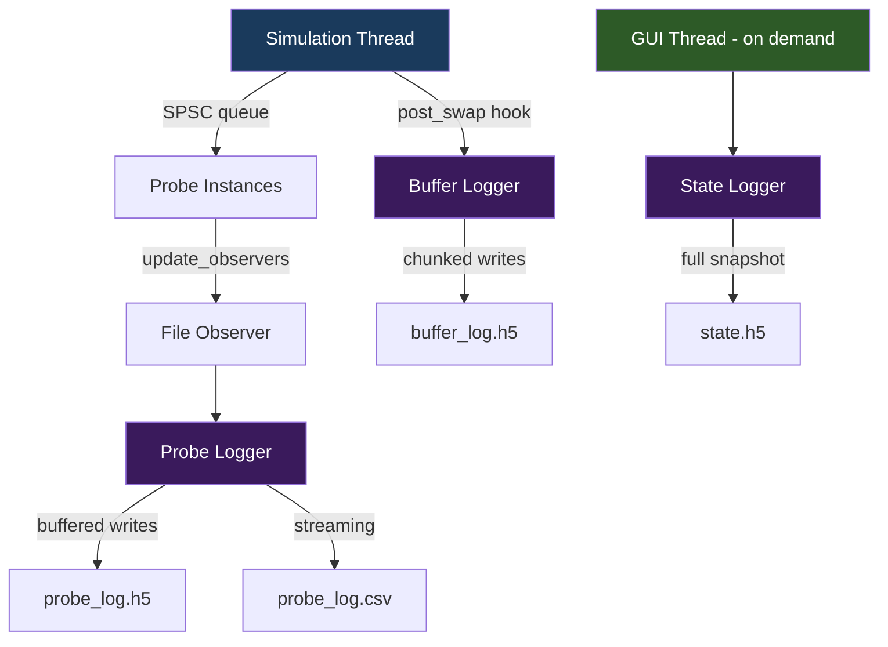

+++
title = "Logging Pipeline"
weight = 40
+++

# Logging Pipeline

How simulation data is persisted to disk.

## Three Logging Paths



## Buffer Logging

**Runs on**: Simulation thread (via post_swap hook)

**Flow**:
1. `start()` registers a `post_swap_hook` with `sim_env`
2. After each `swap_io()`, the hook fires `capture_frame(step)`
3. Copies ALL buffer read data and statistics into a `frame_data` struct
4. Accumulates frames in `frame_buffer_`
5. When `chunk_size` frames accumulate (default 1000):
   - Extends all HDF5 datasets by `chunk_size`
   - Writes via hyperslab selection
   - Flushes HDF5 file

**HDF5 schema**:
```
/metadata/topology/
    buffer_ids [N], buffer_sizes [N], buffer_names [N]
    connectivity [E x 2], vis_hints [N x 3]
/steps/
    step_numbers [T], timestamps [T]
    buffers/<id>/data [T x S]     (float32, chunked, gzip)
    buffers/<id>/stats [T x 5]    (sum, avg, min, max, nse)
```

## Probe Logging

**Runs on**: GUI thread (via observer push during SPSC drain)

**Flow**:
1. `add_probe()` creates a `file_observer` and attaches to the probe instance
2. During `probe_browser.update()` → SPSC drain → `file_observer::push()` → `probe_logger::record_value()`
3. Values are buffered in memory (per-probe vectors)
4. When buffer reaches `buffer_size` (default 10000): flush to disk

**HDF5 schema**:
```
/probes/<sanitized_path>/
    @probe_path = <original_path>
    steps [N], values [N]     (chunked, compressed)
```

**CSV format**: `step,probe1,probe2,...` with one row per step.

## State Persistence

**Runs on**: GUI thread (sim must be paused)

### Save
1. Create HDF5 file with metadata (schema version, step count, config JSON, timestamp)
2. Save all IO buffer read data: `/io_buffers/<id>/data [S]`
3. Call `entity.save_state(writer)` for each entity:
   - Datasets save: `cur_epoch`, `cur_idx`, `ci_cnt`
   - Neuron groups save: group params, neuron state, dendrite state (synapse arrays, segment data)
4. Flush and close

### Load
1. Open HDF5 file, validate schema version
2. Read metadata (step count, config, timestamp)
3. Restore IO buffer data (with size mismatch warnings)
4. Call `entity.load_state(reader)` for each entity
5. Set step counter on thread controller
6. Return result with any warnings

### Auto-Checkpoint

The `logging_window` implements automatic checkpointing:
- Enabled via checkbox + interval (minimum 100 steps)
- Each GUI frame checks if step count has advanced by the interval
- Saves to `<snapshot_dir>/<config>_YYYYMMDD_HHMMSS_<step>.h5`

### Snapshot Resume

On config load, `gui_manager` checks for existing snapshots:
- Scans `<config_dir>/<snapshot_dir>/` for matching `<config_stem>_*.h5`
- If found, prompts "Resume from Snapshot?" / "Start Fresh"
- Resume loads the state and restores the step counter
