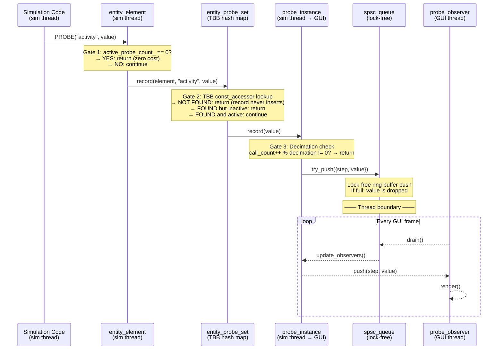

+++
title = "Probe Pipeline"
weight = 30
+++

# Probe Pipeline

How values flow from simulation code to GUI observers.

## End-to-End Flow

## Zero-Cost Fast Path

When no probes are active (the common case), the overhead per `probe()` call is:

**One relaxed atomic load** — `active_probe_count_.load(memory_order_relaxed)`

This counter is maintained by `probe_instance::activate()` and `deactivate()`, which atomically increment/decrement it on the owning `entity_element`.

## Probe Registration

Probes are **lazily discovered**. The first time `PROBE("name", value)` is called at a given call site:

1. A `static bool` guard ensures the name is registered in `probe_name_registry` exactly once
2. The registry maps `typeid(element)` → `set<string>` of probe names
3. The probe browser reads this registry to show available probes

When a probe is activated (checkbox in the browser):

1. `entity_probe_set::activate(element, name, decimation)` is called
2. Creates or finds the `probe_instance` in the TBB concurrent_hash_map
3. Sets `active = true` and increments `element->active_probe_count_`
4. Observer windows are created and attached to the instance

## SPSC Queue Design

The `spsc_queue<probe_sample>` (default capacity 4096) uses:
- **Producer** (sim thread): release store on head
- **Consumer** (GUI thread): acquire load on head

No mutexes, no CAS loops. When the queue is full, values are silently dropped — this is acceptable because the GUI only needs a reasonable sample, not every single value.

## Observer Lifecycle

1. User clicks "+ Obs" in probe browser → selects observer type
2. `probe_instance::add_observer()` adds the observer (GUI thread only)
3. Each frame: `update_observers()` drains SPSC queue → calls `push(step, value)` on each observer
4. User closes observer window → `cleanup_closed_windows()` removes observer
5. When last observer removed → `probe_instance::deactivate()` → decrements `active_probe_count_`
