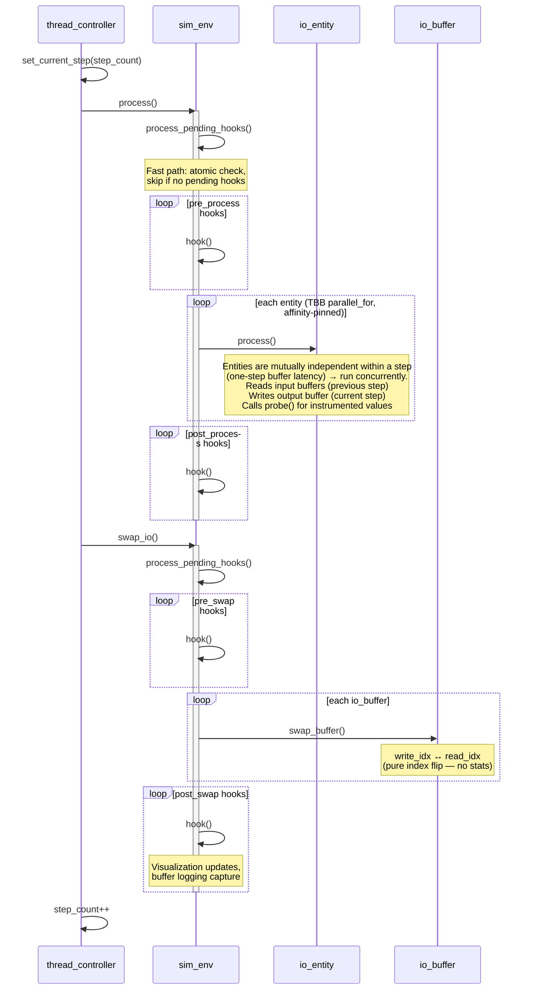

+++
title = "Simulation Loop"
weight = 20
+++

# Simulation Loop

What happens every simulation step and every GUI frame.

## The Simulation Step

Each step executes on the **simulation thread** inside `sim_thread_controller::do_step()`:



## What Happens Inside Entity process()

### Dataset Entity (e.g., mnist_io)

```
1. Get write buffer: output_mem()
2. Copy current sample data into buffer
3. Add noise per element: clamp(val + uniform_noise, 0, 1)
4. Advance sample counter
   → When change_interval reached: next sample
   → When all samples seen: next epoch, wrap
```

### Neuron Group (neuron_group_t)

```
1. Get write buffer: output_mem()
2. For each neuron (parallel):
   activity = neuron.get_response()
   out[neuron.id] = activity
3. Local inhibition: soft winner-take-all
4. Find max activity
5. Stochastic winner selection (within top 20%)
6. Winner adaptation (primary, strong)
7. Common adaptation (secondary, weak, all neurons)
```

See [hd_ngm2 module]({}) for the full algorithm.

## The IO Buffer Swap

The swap creates a **one-step delay**:

```
Before swap:
  Write buffer: current step's output (just produced)
  Read buffer:  previous step's output (being read by consumers)

After swap:
  Read buffer:  current step's output → available to consumers next step
  Write buffer: recycled for next step's output
```

This means consumers always see data from the previous step. This avoids read-write races entirely — no locks needed between entities. It is also what makes the entities mutually independent within a `process()` pass, so `env::process()` dispatches them with a TBB `parallel_for` (CPU∥CPU) rather than a serial loop. A *persistent* `affinity_partitioner` keeps each entity on the same worker core across steps, preserving cache locality and the thread placement the neuron groups' inner `static_partitioner` loops rely on (without it, nesting an outer parallel loop over the inner loops regressed the entity-sparse mnist config ~7%; with it the dispatch is a net win over the old serial loop). Reordering independent entities is provably bit-identical (verified against the golden suite). When a GPU context is present, the recorded GPU batch is submitted *without* an immediate wait so it executes concurrently with these CPU entities.

> **GPU entities** add a second encoder phase to each of `process()` and `swap_io()`, producing two GPU submits per step. The diagram above is the CPU-only path; the GPU-augmented step is traced in [GPU Dispatch]({}).

## The GUI Frame

Each frame of the main loop runs on the **main thread**:

```
1. Poll SDL events (keyboard, mouse, window)
2. State update phase:
   - Check if config load is pending → if yes, construct sim
3. ImGui::NewFrame()
4. GUI callback phase:
   - render_menu_bar()
   - render_dialogs():
     - File browser
     - Control dialog (play/pause/speed)
     - Status dialog
     - Config editor
     - Entity/Buffer/Dataset browsers
     - probe_browser.update() → drain all SPSC queues
     - probe_browser.render() → show observers
     - logging_window.update() → reap completed async checkpoint writes
       (the auto-checkpoint cadence itself runs on the sim thread via a post_swap hook)
     - Buffer replay dialog
     - check_auto_save() → detect pause transition
   - render_status_bar() (FPS, SPS, config path)
5. ImGui::Render()
6. OpenGL draw + swap
```

## Thread Modes

| Mode | Behavior | Pacing |
|------|----------|--------|
| `paused` | No stepping, waits on CV | Wakes for single-step requests |
| `throttled` | Target steps/second | Sleep-based, adjustable 1-250/s |
| `unlimited` | As fast as possible | `yield()` every 1000 steps |

The control dialog's speed slider maps 1-250 to throttled mode, 251 to unlimited.

## SPS Measurement

Measured via exponential moving average over 500ms windows:

```
smoothed_sps = 0.7 * measured + 0.3 * previous
```

Displayed in the status bar as actual vs. target (throttled) or just actual (unlimited).
