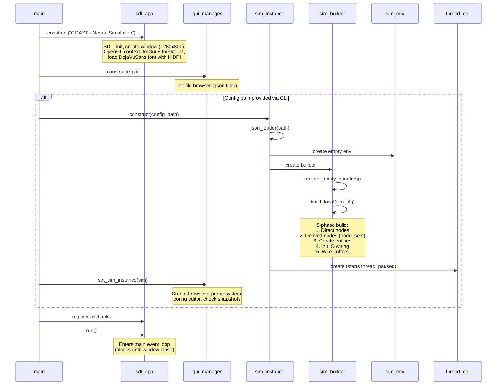

+++
title = "Startup"
weight = 10
+++

# Startup Flow

What happens from program start to the first frame.

## CLI Arguments

```
./build/coast [options] [config.json]

-c, --config <path>     Configuration file
-r, --run               Auto-start simulation
-H, --headless          Headless mode (no GUI)
-n, --steps <count>     Run N steps headless, then exit
--log-buffers <path>    Log all IO buffers to HDF5
--save-state <path>     Save final state
--load-state <path>     Load initial state
--resume                Resume from latest snapshot
--checkpoint <steps>    Auto-checkpoint every N steps
```

`-n` implies headless; `-H` implies auto-start.

## GUI Mode Flow



## Simulation Construction Detail

When `sim_instance` is constructed from a config path:

### 1. Parse JSON
`json_loader` parses the JSON file into `global_cfg_t` — all dataset params, neural model configs, simulation graph, and vis hints.

### 2. Register Entity Handlers
`register_entity_handlers()` registers create/init function pairs for each entity type in the `sim_builder`. Each entity type knows how to look up its config and construct itself.

### 3. build_local() — 5 Phases

**Phase 1**: Copy `sim_node_t` entries from config into the builder's node map.

**Phase 2**: Expand `sim_node_set_t` templates. For each template, create derived nodes with offset IDs and labels. Apply deltas (add/remove inputs) for wiring variations.

**Phase 3**: For each node, call the registered `create_func` to emplace the entity into `sim_env`. Neuron groups are created from `ngm2::cfg_store`, datasets from their respective `*_param_t`.

**Phase 4**: For each entity, build an input map from the node graph (`channel_name → (source_id, source_size)`), then call `init_func`. For neuron groups, this routes channels through the hierarchy: group → neuron sets → dendrite sets.

**Phase 5**: `sim_env.init_io_buffers()` — creates a double-buffered `io_buffer` per entity and wires up the `output_mem()` and `inp_func()` closures.

### 4. Start Thread Controller
Creates a `std::jthread` that starts in `paused` mode, waiting on a condition variable.

## Headless Mode

Skips all GUI setup. Directly creates `sim_instance`, optionally loads state, starts buffer logging, sets a step limit, switches to `unlimited` mode, and polls until completion with periodic progress output.

## Config Load During Runtime

When the user opens a configuration via the GUI:

1. File browser returns a path → stored as `pending_load_path`
2. A "Loading" dialog is shown for ≥2 frames (ensures ImGui renders)
3. State update callback detects `should_start_loading()`:
   - Sets old sim_instance to null (stops sim thread, frees resources)
   - Constructs new `sim_instance` from pending path
   - Attaches to gui_manager via `set_sim_instance()`
   - On failure: stores error message for display
