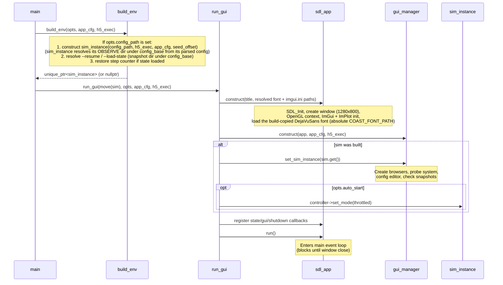

+++
title = "Startup"
weight = 10
+++

# Startup Flow

What happens from program start to the first frame.

## CLI Arguments

```
./build/coast [options] [config.json]

-c, --config <path>     Configuration file
--app-config <path>     Application config (where outputs go, assets); else
                        $COAST_APP_CONFIG > ./coast.json > built-in defaults
--init                  Write a default ./coast.json template and exit
                        (never overwrites an existing one)
-h, --help              Show the usage text
-r, --run               Auto-start simulation
-H, --headless          Headless mode (no GUI)
-n, --steps <count>     Run <count> steps headless, then exit (<count> >= 1)
--unlimited             Run headless with no step limit, until interrupted.
                        Mutually exclusive with -n. Rejects --save-state,
                        --emit-run-manifest and --log-buffers unless
                        --save-on-term is given
--log-buffers <path>    Log all IO buffers to HDF5
--save-state <path>     Save final state (headless only)
--load-state <path>     Load initial state
--resume                Resume from latest snapshot
--checkpoint <steps>    Auto-checkpoint every N steps (headless only)
--save-on-term          Catch SIGTERM (headless only): stop the run, write a
                        final checkpoint (needs --checkpoint), exit through
                        the normal path. SIGINT is not caught
--seed-offset <int>     Offset added to all random seeds (modulo 2^32)
--emit-run-manifest <path>
                        Write a coast_runtime.json run manifest on exit
                        (headless only)

-v, --verbose           Lower the log threshold one level (repeatable)
-q, --quiet             Raise the log threshold one level (repeatable)
--log-level <level>     trace|debug|info|warn|error|off (default: info)
--log-file <target>     stderr (default) | stdout | <path> to append to
```

`-n` implies headless; `-H` implies auto-start. The diagnostics flags drive the [diag]({}) facility — see that page for levels, sinks, and the diagnostics-vs-program-output split.

## Top-Level Dispatch

`main()` is a dispatcher. It does not do simulation work itself — it parses CLI args, constructs the HDF5 executor, builds the env, and hands off to one of two runners (simplified):

```cpp
int main(int argc, char** argv) {
    auto opts = coast::cli::parse(argc, argv);
    if (opts.show_help) { coast::cli::print_usage(...); return 0; }  // before sink setup

    coast::diag::set_level(opts.log_level);                 // configure diagnostics
    /* route --log-file to a stream/file sink */            // before anything logs

    auto app_cfg = coast::paths::load_app_config(opts.app_config_path); // where outputs go

    hdf5::executor h5_exec;                                 // outlives everything

    if (opts.headless && opts.save_on_term) coast::app::arm_term_signal(); // SIGTERM latch
    auto sim = coast::app::build_env(opts, app_cfg, h5_exec); // unique_ptr<sim_instance>

    if (opts.headless) return coast::app::run_headless(*sim, opts, app_cfg);
    std::unique_ptr<coast::console_iface> console;          // console_panel if COAST_WITH_CONSOLE
    return coast::app::run_gui(std::move(sim), opts, app_cfg, h5_exec, std::move(console));
}
```

The **application config** (`load_app_config`) is loaded before anything is built
and passed explicitly to all three runners; it controls *where* per-config outputs
land (`config_base`) and *where* GUI assets come from. See
[Application config]({}).

`build_env()` (in `app/`) is the single place that knows how to turn CLI options into a fully loaded `sim_instance`: it constructs the `sim_instance` (which loads the config and resolves its own OBSERVE output directory under `config_base` from `app_cfg`), applies `--seed-offset`, resolves the snapshot directory under `config_base` for `--resume`, and resolves `--resume` / `--load-state` (restoring the step counter when state is loaded). It returns `nullptr` iff `opts.config_path` is empty (legitimate in GUI mode: the user starts with no sim and opens one from the menu).

A state that cannot be loaded — an unreadable file, a checkpoint of another shape, a corrupt one (see [logging]({})) — throws `state_load_error`, distinct from a configuration failure: `main` logs `Failed to load state from <path>: <reason>` (not `failed to load configuration`) and a headless run exits 1. For a snapshot that `--resume` found rather than one the user named, the message ends with the remedy: `the snapshot was found by --resume in <dir>; drop --resume to start fresh, or move that directory aside`. A config whose shape changed since its last checkpoint therefore no longer "resumes" onto fresh weights.

## GUI Mode Flow

`coast::app::run_gui` owns the SDL/ImGui setup and the menu-driven config-load lifecycle.



## Simulation Construction Detail

When `sim_instance` is constructed from a config path:

### 1. Parse JSON
`json_loader` parses the JSON file into `global_cfg_t` — all dataset params, neural model configs, simulation graph, and vis hints.

### 2. Register Entity Handlers
`register_entity_handlers()` registers create/init function pairs for each entity type in the `sim_builder`. Each entity type knows how to look up its config and construct itself.

### 3. build_local() — 5 Phases

**Phase 1**: Copy `sim_node_t` entries from config into the builder's node map.

**Phase 2**: Expand `sim_node_set_t` templates. For each template, create derived nodes with offset IDs and labels. Apply deltas (add/remove inputs) for wiring variations.

**Phase 3**: For each node, call the registered `create_func` to emplace the entity into `sim_env`. Neuron groups are created from `ngm2::cfg_store`, datasets from their respective `*_param_t`.

**Phase 4**: For each entity, build an input map from the node graph (`channel_name → (source_id, source_size)`), then call `init_func`. For neuron groups, this routes channels through the hierarchy: group → neuron sets → dendrite sets.

**Phase 5**: `sim_env.init_io_buffers()` — creates a double-buffered `io_buffer` per entity and binds each entity to its buffers (`set_output_buffer` / `set_input_buffer`).

### 4. Start Thread Controller
Creates a `std::jthread` that starts in `paused` mode, waiting on a condition variable.

## Headless Mode

`coast::app::run_headless` is invoked when `opts.headless` is true (set explicitly by `-H`, implied by `-n`/`--unlimited`, and unconditional in a `COAST_WITH_GUI=OFF` build).

Every headless run must state how long it lasts, so `opts.steps_mode` is never `unset` by the time `run_headless` sees it. The enforcement is split across two places on purpose: `cli::parse` rejects an explicit `-H`/`--headless` with no length (build-independent, so its unit tests mean the same thing in both configurations), while `main()` applies the same rule — and the same message — where a `COAST_WITH_GUI=OFF` build promotes an unmarked run to headless. There is deliberately no default and no sentinel: `-n 0` is an error rather than "run forever", because a step count that is mistyped or computed to zero must not silently start an unbounded job. An unbounded run is spelled `--unlimited`.

`--unlimited` in turn refuses `--save-state`, `--emit-run-manifest` and `--log-buffers` unless `--save-on-term` is given. Such a run ends only by being killed, and without `--save-on-term` COAST catches no signal, so those outputs are not merely absent — the first two are never written at all (both happen on the way out) and the third leaves an unclosed, unreadable HDF5 file. `--save-on-term` installs a `SIGTERM` latch (`arm_term_signal`, armed in `main()` before `build_env`) that the run loop watches; a `SIGTERM` then ends the run through the normal exit path, which writes them. `SIGINT` is still not caught. `--checkpoint` is explicitly still allowed: its snapshots are written *and closed* during the run, making it the way to get data out of an unbounded run without `--save-on-term`.

It skips all GUI setup and drives the (already-built) `sim_instance` synchronously:

1. Optionally starts buffer logging (`--log-buffers`).
2. For a finite run, sets `step_limit = current_step + opts.max_steps`; for `--unlimited`, sets no limit at all. Either way it switches the controller to the `unlimited` *speed* mode (run as fast as possible) — a separate concept from the step limit, despite the shared word.
3. Polls the step count with adaptive sleep intervals (100 ms → 10 ms → 1 ms as the limit approaches), invoking probe-observer updates each tick.
4. Saves checkpoints at `opts.checkpoint_interval` if requested.
5. On completion: stops buffer logging, optionally saves final state (`--save-state`), reports stats.

Throughout the run it emits structured `@coast/progress` lines on stdout alongside the human narration (phases `start` / `step` / `checkpoint` / `done` / `failed`), so an external supervisor parses a stable schema rather than the free-form prose — see [diag]({}). It also sets `std::cout << std::unitbuf` so the human progress line-flushes when stdout is redirected to a file.

Checkpoints (`--checkpoint`) extract inline on the sim thread from a `post_swap_hook` at the coherent post-swap boundary (**not** `run_quiesced` — the hook already runs at that boundary), then serialize async on the HDF5 executor. The final `--save-state` uses the quiesced split (extract via `run_quiesced` on the sim thread, serialize on the executor). Both **await the pending write futures** before recording savestate sizes in the run manifest (a checkpoint write that has already finished is reaped during the run by the poll loop, so a failed one is reported when it fails, not only at exit) — see [Logging Pipeline]({}).

`--resume` / `--load-state` are handled by `build_env`, not by `run_headless` — by the time `run_headless` is called, the sim's step counter is already at the restored value, and `opts.max_steps` is interpreted as *additional* steps to run. This startup load is the one path allowed to bypass `run_quiesced` (`load_state_startup`): the sim thread is parked and has never stepped, so the load is concurrency-free.

## Config Load During Runtime

When the user opens a configuration via the GUI menu (inside `run_gui`):

1. File browser returns a path → stored as `pending_load_path` on `gui_manager`.
2. A "Loading" dialog is shown for ≥2 frames (ensures ImGui renders).
3. The state-update callback registered by `run_gui` detects `should_start_loading()`:
   - Detaches the old `sim_instance` from `gui_manager` (`set_sim_instance(nullptr)` — frees browser GL resources while the GL context is still valid).
   - Resets the owning `unique_ptr<sim_instance>` (stops sim thread, destroys env).
   - Constructs a new `sim_instance` directly from the pending path (this path does not run through `build_env` — `--load-state`/`--resume` apply only to the initial CLI-driven load), passing the app config so the new `sim_instance` resolves its OBSERVE directory under `config_base` just like the initial load.
   - Re-attaches via `gui_manager.set_sim_instance()`.
   - On failure: stores the error message for display in a modal.
