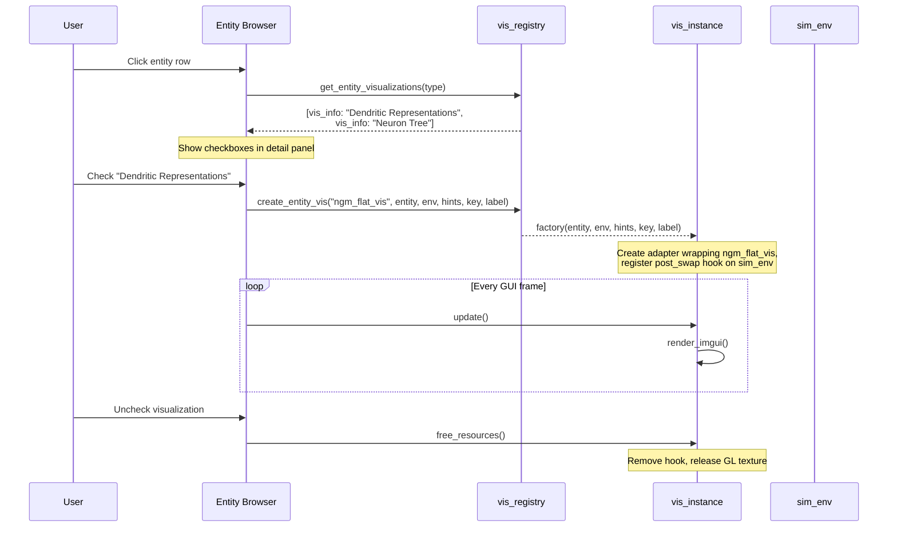

+++
title = "Visualization"
weight = 50
+++

# Visualization Flow

How simulation data gets rendered on screen.

## Registry-Driven Creation



## Thread-Safe Update Pattern

Visualizations need fresh data from the simulation thread but render on the GUI thread. They use a **3-state atomic FSM**:

```
                     sim thread triggers
   ┌───────┐          hook callback           ┌───────────┐
   │ idle  │ ─────────────────────────────────>│ requested │
   └───────┘                                   └───────────┘
       ^                                            │
       │                                            │ GUI thread detects
       │                                            │ in update()
       │                                            v
       │         GUI thread finishes          ┌───────────┐
       └──────────────────────────────────────│ updating  │
                                              └───────────┘
```

**Sim thread** (post_swap hook): Tries to CAS `idle → requested`. If the GUI is still `updating`, the sim thread yields briefly (100ms timeout), then cancels if not completed.

**GUI thread** (`update()`): Checks for `requested` state, CAS to `updating`, copies data from the entity/buffer, CAS back to `idle`.

This ensures:
- No locks or mutexes
- The sim thread is never blocked for long
- The GUI sees consistent data (copied atomically from the sim thread's perspective)

## Visualization Modes

### Dendritic Representations (ngm_flat_vis)

Shows all neuron representations as a 2D grid:

1. For each neuron → dendrite → representation (leaf segment):
   - Read synapse permanence values
   - Apply 5-stop gradient from current colormap
   - Write pixels into a large buffer
2. Upload pixel buffer to GL texture
3. Render in ImGui window with zoomable/pannable canvas

### Neuron Tree (ngm_tree_vis)

Force-directed tree showing dendrite structure:

1. **Create model**: Build nodes for each segment in the binary tree, edges for parent-child, root nodes for neurons
2. **Update model**: Detect new segments from branching, create nodes dynamically
3. **Update representations**: Regenerate leaf textures from synapse permanences
4. **Layout**: Force-directed (fbgd) with adaptive repulsion radii
5. **Render**: Draw edges, circles (root/branch nodes), leaf textures on ImDrawList

### Time Series (vec_ring_buffer)

Scrolling texture for IO buffers:

1. Each update: write one column (buffer values → colormap → pixels)
2. Circular write pointer advances
3. Texture wraps around, creating a scrolling display
4. Auto-normalized (min/max from buffer stats)

## Vis Hints

The `vis_hints_t` from the JSON config flows through the factory to parameterize visualizations:

```
JSON config → json_loader → global_cfg_t.vis_hints
  → sim_builder_cfg → sim_instance
    → entity_browser → vis_registry.create_entity_vis(hints_key)
      → factory looks up hints.ngm2.neuron_groups[hints_key]
        → Sets width, height, num_channels, update_interval, colors, ...
```

Each hints map has a `"default"` entry for fallback.
