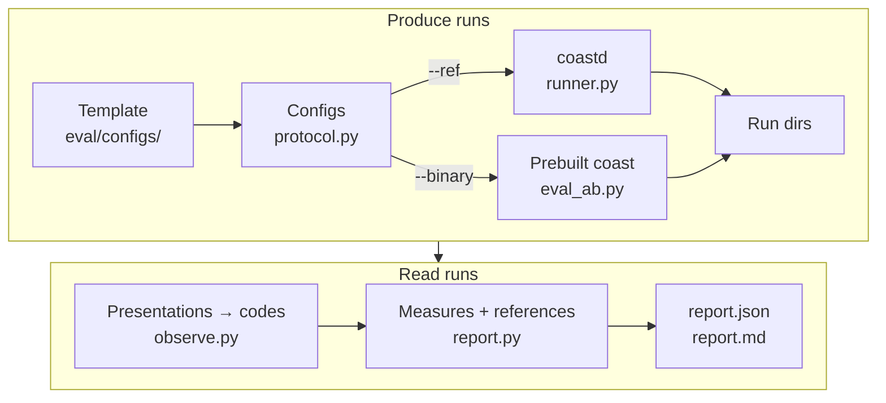

+++
title = "Frozen Evaluation"
weight = 10
+++

# Frozen Evaluation

The frozen evaluation asks what a trained population **represents**, not whether the code still produces the same numbers. It trains a model, freezes it, shows it held-out images, and measures the codes it answers with. Two code states are compared on the same protocol. This is milestone 1 of issue [#82](https://github.com/cimcai/coast/issues/82) (the bottom-up evaluation roadmap).

It is not a regression test. The test tiers on the [section page]({}) pin current behaviour. The frozen evaluation measures properties that are expected to change when the model changes, and reports which way they moved.

The toolkit is a Python package, `eval/` (`coast_eval`), with three drivers in `scripts/` (`fetch_mnist_c.py`, `eval_ab.py`, `eval_settling.py`) and two report tools beside them (`eval_plot.py`, `eval_report_upgrade.py`). Its development rules and the decisions behind the protocol are in `design/eval_python_toolkit_brief.md`, and that brief is the authority on them. This page explains how the pieces fit.

## What it measures, in plain words

A frozen population answers each image with a **code**: the set of units that win, together with their amplitudes. The group does not see an image, though. It sees a bundle of input axons, one per pixel, with no notion of which axons are neighbours. Two inputs are alike to it only as far as they drive the same axons: a "1" shifted sideways until its stroke covers other pixels is an entirely different input. A good code does two things:

- **It keeps the input's overlap.** Inputs that drive the same axons get similar codes, and inputs that drive different axons get different ones.
- **It survives corruption.** A corruption removes signal from axons that were active and adds signal on axons that were silent. While enough of the original signal survives, the corrupted input still gets a code closer to its own clean code than to the codes of other images.

The evaluation measures both. It reports them next to references that say what "good" means here: raw pixels, a random projection with the same code sizes, and an input with no image at all. With a retina template, a centre-surround filter in front of the group makes each retina axon carry a weighted patch of nearby pixels, so a small shift still leaves some axons shared. The group itself still has no neighbourhood.

## How a run flows



1. **`protocol.py`** turns a template into coast configs: one training job per seed, then one frozen job per seed and condition. It changes only what the protocol fixes (the image manifests, the presentation rate, the input noise, learning on or off, the observe window, the seed) and leaves the model as the template has it.
2. **The runs.** `--ref` submits the jobs to [coastd]({}), which builds coast at that git ref and supervises the runs (`runner.py`, the normal path). `--binary` runs a prebuilt coast in place, for a code state that is not a git ref. Both produce the same run-directory layout. Every run's manifest is checked before it is read: the git SHA, a clean build, the step count, and no resume where a resume would restart the image sequence.
3. **`observe.py`** reads each frozen trial's `population/out` and `input/index` observe files. It splits them into presentations on the dataset's own image index and reduces each presentation to one code.
4. **`report.py`** computes the measures per training seed, adds the references, and applies the reading rule when there are two states. It writes JSON, from which the Markdown is regenerated.

## The protocol

| Part | Setting | Why |
|---|---|---|
| Training | 1M steps at 1 step per image, the 60k MNIST training images reshuffled every pass, per seed | 1 step per image is the shipped configs' rate. Saturation runs showed shorter training is badly under-trained. A fixed order would be the same for every seed. |
| Frozen trials | Learning off, the trained state loaded, 15 steps per image | One trial per condition and seed |
| Test images | 1000 held-out images, a fixed random sample below index 9000 (`protocol.evaluation_sample`) | MNIST's first test images are its cleaner half. Images 9000–9999 calibrate the retina templates. |
| Conditions | Clean, the 15 MNIST-C corruptions, and all-zero input | Every input file is checked against its SHA256 pin before any run |
| Settle lead | The hop count from the dataset to the group: 1 for pixel input, 2 with a retina | Each hop is one buffered step. The steps after the lead are averaged into the presentation's code. |
| Code | Units with amplitude at least 0.3 of the presentation's maximum | A relative rule, so a code does not depend on the overall amplitude scale |
| Replicates | Training seeds | Frozen trials from one trained state differ by condition only: the loaded random state wins over the config's seed |

The settle lead is measured, not only inferred. `scripts/eval_settling.py` shows each image for 30 steps and compares every step's code with the settled one. Before the lead, a step still shows the previous image; after it, the code stays flat. `--template` chooses the template (the pixel one by default), and the reference code averages steps h + 2 to 15 for h hops: steps 3 to 15 for pixels, 4 to 15 with a retina. The reference therefore starts one step after the first step expected to have settled, so that step is compared with a code that does not contain it. On both templates the measured lead is the hop count: 1 for pixels, 2 with a retina.

### Noise floors

The protocol zeroes the dataset's input noise, so a frozen trial sees each image as it is. Two other noise sources stay at the template's values, on purpose:

- **Neuron baseline noise.** In the NGM model, a neuron's resting state is its baseline noise, not zero. Removing it would change what the model is.
- **A retina's output noise.** It is the retina's designed null signal. coast refuses to set it to zero, because the dendrite's per-input normalisation divides by it.

So a pixel-vs-retina comparison also compares an input without a noise floor against one with it.

## The measures

Everything is computed per training seed, on the codes of the frozen trials.

**Primary measures** (the reading rule applies to these):

- **Kendall τ-a** (`kendall_tau_a`) asks whether codes keep the input's overlap. It ranks all image pairs by pixel-cosine distance, which is small when two images drive the same input axons, and by code-cosine distance, and counts how often the two orders agree. With a retina template these are still the raw pixels, not the retina's output. Ties count against agreement. Higher means the code orders images more like their axon overlap does.
- **Matched/mismatched AUC** (`model/<corruption>`) asks whether a corrupted input still gets its own code. For each corruption it compares each clean code's cosine to the code of the same image corrupted (matched) against its cosine to the corrupted codes of other images (mismatched), as an area under the curve. 0.5 is chance and 1.0 is perfect. Cosine is taken over the union of the two codes' winners.
- **MNIST-C mean and worst** summarise the 15 corruptions.

**Secondary measures** (reported, not judged):

- **Separation** is the mean cosine between codes of different images.
- **Never-wins** is the fraction of units that win on no image.
- **Domination** is the largest share of presentations won by a single unit.

Separation and domination rise with **code size alone**: more winners per image means more overlap and more wins per unit, with no structure at all. So the report gives each its **chance level** (`separation_chance`, `domination_chance`). These are the same measures with each presentation's units shuffled, keeping its code size and amplitudes, averaged over the projection seeds. Read separation and domination against these, not against another template's values.

**Controls**, which say where a code sits:

- **Random WTA reference** (`random/<s>/...`): a random projection of the pixels, with each image's code size matched to that seed's clean code. A learned code should do better than an untrained projection of the same size. Projection seeds are nested inside each training seed. They are controls, not replicates.
- **Pixel reference** (`pixel/...`): the same AUC on raw pixel vectors, that is, on the input axons before any model. It shows how much of the original signal a corruption leaves in place.
- **Zero-input control** (`model/zeros`): an all-zero image set, every input axon silent. With no image, the peak amplitude is baseline neuron noise, so nearly every unit wins every presentation. The control gives full codes, not empty ones, and its AUC is chance.
- **Code size** (`code_size/<condition>`): the mean number of winners per presentation.

### The reading rule

The rule reads a comparison of two code states. Each training seed gives one after-minus-before difference per primary measure, and a measure **moved** only if every seed's difference has the same sign: all above zero, or all below. One seed the other way, or one unchanged, and the report says "not all n moved in the same direction". There are no thresholds, no aggregate verdict and no significance claim. With few seeds, "all seeds moved" also happens by chance, so a report is read as what moved and in which direction, not as proof.

## Running it

All five scripts are [uv](https://docs.astral.sh/uv/) scripts. uv is a Python package and environment manager: each script starts with `#!/usr/bin/env -S uv run --script` and lists its dependencies in a comment block at its top, so running it directly makes uv set up a cached Python environment with them (the `coast_eval` package from `eval/` among them) and run the script in it. Nothing besides uv needs installing by hand. The drivers check their inputs against SHA256 pins (`coast_eval.datasets.PINS`) before any run.

```bash
# MNIST-C as the IDX files coast reads, checked against the pins (downloads if needed)
scripts/fetch_mnist_c.py --data-root data

# Two code states through coastd (the normal path)
scripts/eval_ab.py --ref before <sha> --ref after <sha> --ports-file <data-root>/coastd.ports \
    --dataset-base data --data-root data --out tmp/ab --report-dir tmp/ab

# Prebuilt binaries, for a state that is not a git ref
scripts/eval_ab.py --binary before <coast> <sha> --binary after <coast> <sha> \
    --data-root data --out tmp/ab --report-dir tmp/ab

# The settling curve behind the settle lead (pixel template unless --template is given)
scripts/eval_settling.py --binary <coast> <sha> --data-root data --out tmp/settling \
    --report-dir tmp/settling [--template eval/configs/<template>.json]
```

- **Templates.** Each state runs the pixel template (`eval/configs/mnist_ngm25_frozen_eval.json`) unless `--template LABEL PATH` names another, such as a retina template. The report records each state's template.
- **Reuse.** A `--binary` run whose config, binary, loaded state and inputs are unchanged is not run again, so an interrupted comparison picks up where it stopped.

## Where the results go

Reports are **not committed** to this repository. A report is generated output: nothing here reads it, and a comparison is thousands of lines. Full reports, findings and planned experiments live in the private `policecar/roast` repository, whose README is the index. A rule chosen from a measurement goes into the brief, with a pointer to the report behind it.

Figures are never committed either: `*.svg`, `*.png` and `*.pdf` are ignored repo-wide, except under `docs/static/`. They are regenerated from a report's numbers by `scripts/eval_plot.py`.
