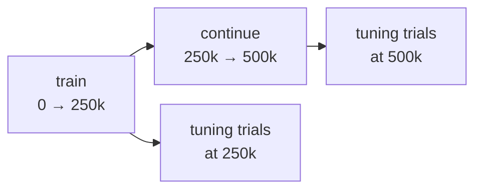

+++
title = "Hyperparameter Sweep"
weight = 20
+++

# Hyperparameter Sweep

A sweep runs the [frozen evaluation]({}) for many settings of one template: every variant, at every seed and every training length, with one report per (variant, length). It answers "which settings are worth a full evaluation", not "is this setting better": a sweep scores its settings on **tuning images**, never on the evaluation sample, and the winners are then compared on the evaluation sample with `scripts/eval_ab.py`.

The tool is `scripts/eval_sweep.py`, on top of `coast_eval.sweep`. It runs through [coastd]({}) only, with the same placement, ledger and run checks as `eval_ab.py --ref`. The design is `design/eval_sweep_plan.md`.

## The spec

A sweep is described by a JSON spec. The stage-1 spec is `eval/sweeps/stage1_ngm25_lr_inhib.json`:

```json
{"schema": "coast-eval-sweep-spec/1",
 "template": "eval/configs/mnist_ngm25_frozen_eval.json",
 "axes": {
   "/ngm25/neuron_groups/L4-mnist/primary_learning_rate": [0.01, 0.03, 0.1, 0.3],
   "/ngm25/neuron_groups/L4-mnist/secondary_learning_rate":
     {"ratio_of": "/ngm25/neuron_groups/L4-mnist/primary_learning_rate",
      "factors": [0.001, 0.01, 0.1]},
   "/ngm25/inhibitions/ab_pinned/strength": [1, 5, 10, 20],
   "/ngm25/neuron_groups/L4-mnist/common_learning_rate": [0.0001, 0.001]},
 "seeds": [0, 1],
 "lengths": [250000, 500000],
 "conditions": ["clean", "brightness", "...all 15 MNIST-C corruptions...", "zeros"],
 "tuning_images": 1000}
```

| Field | Meaning |
|---|---|
| `template` | The base configuration, relative to the repository root. It must leave `run_id` at `"auto"`. |
| `axes` | JSON pointer into the template → list of values. The axes expand to their full grid. |
| `variants` | Optional: name → `{pointer: value, …}`, extra override sets beside the grid. |
| `seeds` | Training seeds, the replicates. Seed s runs on daemon s mod N, as in `eval_ab.py`. |
| `lengths` | Training lengths in steps, increasing. Each is one point of every variant. |
| `conditions` | Tuning conditions, from `clean`, the 15 MNIST-C corruptions and `zeros`. A report summarises MNIST-C only over all 15, so give none or all of them. |
| `tuning_images` | How many tuning images each trial presents, at most 1000. |

**Variants.** The template unchanged is always the variant `base`. A grid variant is named by its values, `key=value` per axis joined by `,`, where `key` is the pointer's last key: `primary_learning_rate=0.1,secondary_learning_rate=x0.01,strength=10,common_learning_rate=0.001`. Named variants keep their names; `base` and grid names are reserved. A grid point whose values are all the template's is `base` itself: it is not run twice, and `sweep.json` lists it under `aliases` (grid name → `base`). "The same value" is one rule, `sweep.same_value`: numbers within a relative 1e-9 (a derived value is a float product, `0.1 × 0.1` is `0.010000000000000002`; `1` and `1.0` are one value), anything else exactly. It also refuses an axis with two values that are the same.

**Derived axes.** `{"ratio_of": <pointer>, "factors": [...]}` takes, at each grid point, the value of another axis times each factor. Stage 1 needs it because the secondary learning rate must stay below the primary one at every primary rate, which a list of absolute values cannot guarantee. The variant name shows the factor (`secondary_learning_rate=x0.01`), not the product. The referenced axis must be a plain list axis of the same spec.

**What the spec may not do.** Every pointer must exist in the template. coast only warns on an unknown key, so a misspelt pointer would otherwise run the template's value under the variant's name. The keys the protocol writes itself (the dataset's files, rate, noise and shuffle, `frozen`, `run_id`, the observe groups and the seeds) cannot be overridden: the protocol would undo the override, or the run checks would refuse the run. Axis values must be scalars; put a list or object value in a named variant.

## How a sweep runs



Each (variant, seed) is one chain. The first job trains to the first length. Each further length is a continuation job: it loads the previous job's final state (coastd's `load_state_from`) and runs under the same `run_id`, so coast continues the shuffled train sequence where it stopped instead of starting it again. coastd accepts only a done job's final state, which is why a length is a job of its own, not a snapshot. After each training job, the tuning trials run frozen from its state, one per condition.

Everything is submitted to coastd as soon as it can be: the first training job of every chain at once, the rest as their source jobs finish. Continuations and tuning trials carry a higher coastd priority than first training jobs, so points finish chain by chain instead of after every first training job. That is a hint to coastd's queue; how many jobs run at a time is the daemons' business (`--slots`), and the tool does not schedule.

## Tuning images, never test images

A setting chosen by its score on the evaluation sample would then be scored on the very images it was chosen on. So the tuning trials present images **held out of the train set**:

- `protocol.tuning_split(n)` is the first n entries of a fixed random permutation of the 60 000 train indices (`TUNING_SEED`).
- The training manifest of a sweep leaves those n images out.
- `clean` shows them from MNIST's train split, a corruption from MNIST-C's **train** split (`mnist_c/<corruption>/tuning-images-idx3-ubyte`, written by `scripts/fetch_mnist_c.py`), `zeros` an all-zero set of the same shape.
- A tuning trial that would read a file of the test split (`t10k-…`) is refused. The evaluation sample and the retina's calibration images are therefore out of reach by construction.

In the per-point reports, `protocol.test_indices` are the presented rows of the tuning files (0 … n−1), not test images.

The MNIST-C tuning files are pinned by SHA-256 like every other input (`datasets.TUNING_PINS`). They hold the rows of one permutation, so the permutation is pinned too (`protocol.TUNING_POOL_SHA256`): a numpy whose random stream gives another one is refused before anything is written. `scripts/fetch_mnist_c.py --data-root <data>` writes and checks them under a data root, beside the test files; the daemons' `dataset_base` needs them too.

## Running it

```bash
scripts/eval_sweep.py --spec eval/sweeps/stage1_ngm25_lr_inhib.json --ref main <sha> \
    --daemon host-a --daemon host-b --dataset-base <NAS>/datasets --data-root data \
    --out tmp/sweep
```

`--ref LABEL SHA` names the one code state all variants run at; SHA must be a full commit SHA. `--daemon`, `--dataset-base` and `--data-root` mean what they mean for `eval_ab.py --ref`.

**Resume.** Run the same command again. The ledger (`<out>/ledger.json`) re-attaches to the sweep's jobs, and a point whose `report.json` exists is not run again. A changed spec, template, ref, protocol or set of daemons is a different sweep: its ledger is refused, and so is an `--out` whose `sweep.json` carries another sweep's fingerprint or whose reports name another ref.

**Cancel.** The same command with `--cancel` cancels every active job of the sweep.

**Redo.** A run dir the checks refuse is named by its key, `<variant>/<length>/<seed>/<condition>`. The same command with `--redo KEY` submits it afresh and continues; a training key also redoes the later lengths of its chain and all their trials. A key is refused while a point it would redo has a report, the later lengths of a training key included (that report would stay from the old chain): remove the reports first.

## Output

```
<out>/sweep.json                       the index (coast-eval-sweep/1)
<out>/<variant>/<length>/report.json   one point: one state, labelled by the variant, all seeds
<out>/<variant>/<length>/report.md
<out>/ledger.json                      the runner's ledger
<out>/inputs/                          the manifests and tuning files shipped to the daemons
```

`sweep.json` records the spec as submitted, the template's SHA-256, the ref, the daemons, every variant's overrides and the grid names aliased to `base`, and lists each point with its report path, seeds and status: `done` once its report exists, `failed` when one of its jobs, or its report, stopped the last run, `pending` otherwise. It is rewritten as points finish, so it can be read while the sweep runs. Each report is the frozen evaluation's report of one state (`report.build`); `scripts/eval_sweep_report.py` reads `sweep.json` and the reports and compares every variant with `base`.
