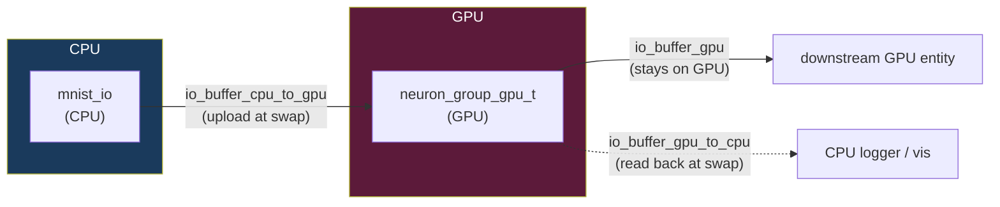
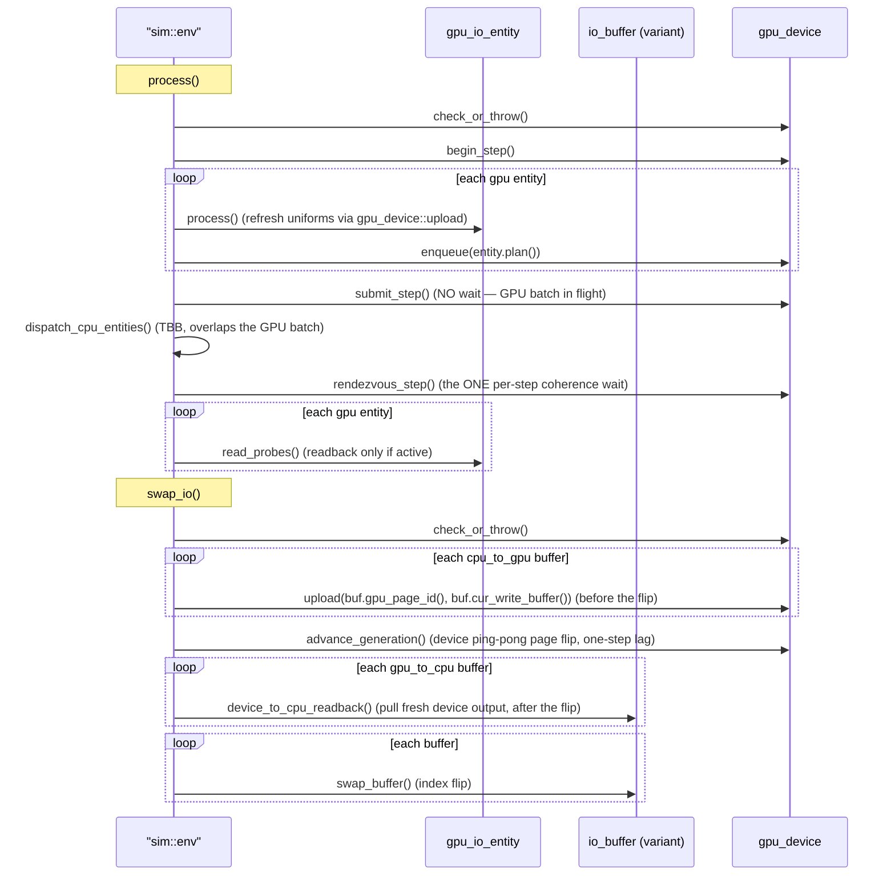

+++
title = "Heterogeneous Execution"
weight = 35
+++

# Heterogeneous Execution — CPU and GPU Entities Side by Side

COAST can run individual entities **entirely on the CPU** or **entirely on the GPU** within the same simulation. The two device worlds meet at exactly one place: the `io_buffer`. This page is the mental model for that mechanism — read it before the per-module GPU pages, because every one of them rests on the rules stated here.

The work was added by the *ngm3-gpu-port* cycle. Its value is **capability, not speed**: on the development machine (AMD Strix Halo, LPDDR5x unified memory) the memory-bound ngm3 GPU path is *expected* to be no faster than the CPU path. The point is that the framework now expresses the CPU↔GPU boundary structurally, which pays off on platforms where the GPU memory subsystem dominates (e.g. Apple Silicon).

## The One Rule

> **Every `io_entity` executes entirely on one device — CPU or GPU, never both, never in between. All inter-entity communication crosses an `io_buffer` at the swap boundary, never directly.**

This is the *entity-device rule*. It is what makes heterogeneous placement tractable: a simulation step is a *bag of independent entity executions*, and "which device runs which entity" becomes a placement decision with no synchronization beyond the per-step buffer swap. It rests on three pre-existing COAST invariants (each audited against the actual code during the Demonstrate stage and found to hold *structurally*, not by convention):

1. **Single-writer per buffer** — each buffer is written by exactly one entity.
2. **Buffer-only communication** — entities share no state outside buffers (no shared RNG, no cross-entity pointers, no globals).
3. **One-step latency** — a reader always sees the *previous* step's output (double buffering).

Because of these, a GPU entity can be dropped in as a *sibling* of a CPU entity with no audit of the existing entities for hidden coupling.

## The Seam: Four `io_buffer` Variants

`io_buffer` became an **abstract virtual base** with four concrete variants. The variant of each buffer is chosen automatically from the devices of its writer and readers — see [IO Buffer]({}) for the contract and field layouts.

| Writer | Any GPU reader? | Any CPU reader? | Variant | Cross-device work at swap |
|--------|-----------------|-----------------|---------|---------------------------|
| CPU | no  | (any) | `io_buffer_cpu` | none |
| CPU | yes | (any) | `io_buffer_cpu_to_gpu` | `wgpuQueueWriteBuffer` upload |
| GPU | (any) | yes | `io_buffer_gpu_to_cpu` | `CopyBufferToBuffer` → staging → map back |
| GPU | yes | no  | `io_buffer_gpu` | none (stays GPU-resident) |

Selection is a pure function of `(writer.device, has-GPU-reader, has-CPU-reader)`. In a CPU-only configuration every buffer is an `io_buffer_cpu` and the GPU machinery never activates.



## How a GPU Entity Is Expressed

The type system carries the device — there is **no runtime device tag**. A GPU entity derives from `gpu_io_entity` (an intermediate base between `io_entity` and the concrete class):

```cpp
class gpu_io_entity : public io_entity {
public:
    virtual void  build_step_plan(gpu::gpu_device&) = 0;  // build the static plan ONCE at construction
    virtual gpu::plan_id plan() const = 0;                // opaque id of that plan
    virtual std::uint64_t graph_epoch() const { return 0; }
    virtual void  read_probes() {}                        // post-rendezvous readback hook
};
```

The dispatcher identifies GPU work with `dynamic_cast<gpu_io_entity*>(&entity)` at the entity loop (a handful of entities per step — negligible against kernel cost). A separate `device_kind` enum was considered and **rejected** (it would duplicate information the hierarchy already encodes and risk drift). See [io_entity]({}).

A GPU entity never names WebGPU — it talks only to the agnostic `gpu_device` facade through opaque handles. Its per-step work splits in two:
- **`build_step_plan()`** runs *once at construction*: it registers the entity's buffers and kernels with the device, emits the op list, and builds a static `step_plan` (`register_plan` / `build_plan`). The dispatcher later enqueues this plan by its opaque `plan()` id; the op graph is constant across steps (`graph_epoch()` is 0 this cycle).
- **`process()`** runs every step and does only *host-side bookkeeping* — advancing counters and refreshing the small uniform buffers the plan reads (`gpu_device::upload`).

## The Step: Submit, Overlap, Rendezvous

The dispatcher maps cleanly onto the existing `process()` / `swap_io()` boundary and drives the GPU entirely through the agnostic `gpu_device` facade. The GPU batch is submitted **without waiting**, so the CPU entities overlap the in-flight GPU work; a single `rendezvous_step()` is the one mandatory per-step coherence wait. The number of GPU dispatches enqueued per step is independent of how many GPU entities or buffers exist (the O(1)-submission property, MH7):



Cross-device data movement happens in `swap_io()` around `advance_generation()`: `cpu_to_gpu` uploads the just-written write page *before* the device page flip, `gpu_to_cpu` reads back the fresh device output *after* it — preserving the one-step latency invariant for all four variants. The full per-step trace is in [GPU Dispatch]({}).

## The GPU Context

A single `coast::gpu::gpu_context` (held as a `std::unique_ptr` on `sim::env`) owns the wgpu instance/adapter/device/queue. It is constructed lazily — only when a configuration actually contains a GPU entity — so CPU-only runs never touch wgpu. The framework is built on **wgpu-native** (the Rust WebGPU implementation), selecting the **Vulkan** backend on Linux and **Metal** on macOS, chosen at compile time. See the [core/gpu module]({}).

## Boundaries (read these before extending)

- **CPU/GPU overlap within a step, but no cross-step pipelining.** The GPU batch is submitted without waiting and the CPU entities run concurrently with it, but `rendezvous_step()` (a `wait_idle` in the backend) forces full coherence at the end of every `process()`. Pipelining step N+1's recording over step N's execution is explicitly out of scope.
- **GPU RNG is not bit-equivalent to the CPU.** GPU kernels use a *stateless* PCG hash PRNG, not the CPU's `mt19937_simd` stream. Parity between CPU and GPU ngm3 is therefore **statistical-aggregate**, not per-step numerical — see [Architecture Decisions]({}) (MH3) and [Testing → Golden Protocol]({}).
- **Faults crash.** An unrecoverable wgpu error (device lost, validation failure) is flagged on the context and re-raised at the next phase boundary via `check_or_throw()`. There is no GUI fault-recovery story in this cycle; crashing is the correct outcome for an unrecoverable error.
- **No GPU performance tuning was done.** The bar for the GPU entities is "correct, runs, hashable." On Strix Halo the GPU ngm3 mean runs ~16–25 % below the CPU reference (documented in `benchmarks/ngm3_aggregate_noise_floor.md`); this is a known, accepted fidelity gap, not a regression.
