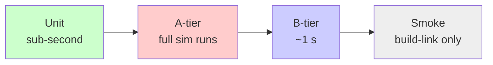

+++
title = "Testing"
weight = 60
+++

# Testing Infrastructure

The COAST test suite exists for **regression prevention**. Its purpose is to pin the simulation's current observable behavior as a contract, so that future edits — and in particular agent-driven edits — cannot silently change it without a developer noticing.

This is a deliberate scoping choice. The suite does **not** validate that COAST's output matches an independent specification of what HD-NGM2 *should* produce; it locks in what the current code actually produces. Correctness is the developer's job; regression is the suite's job.

## Mental Model

There are four code-bearing test tiers and two CMake-only quality gates:

| Tier | Lives in | Catches |
|------|----------|---------|
| **Unit** | `tests/unit/<module>/` | Logic errors in pure-ish components: CLI parsing, JSON config loading, SPSC queue mechanics, probe decimation, `coast_compare` itself |
| **A-tier integration** | `tests/integration/<test>/` | Behavior drift in a full simulation run. The tripwire. |
| **B-tier integration** | `tests/integration_b/` | CLI surface regressions: argv handling, exit codes, file side-effects of `--save-state`/`--load-state`/`--checkpoint`/`--log-buffers` |
| **GUI smoke** | `tests/smoke/` | Build/link sanity for the GUI binary. Per-component construct-and-tick smoke tests are deferred (see [Tier model]({})). |
| **coastd** | `tests/unit/coastd/` | The [daemon]({}): a pure state machine, the durable store, subprocess supervision, the wire protocol, and an end-to-end bit-identity gate against the real `coast` (`gate.coastd.real_coast`). Filed under *unit* by ctest name (`unit.coastd.*`) but spans the whole range — see below. |
| `clang-tidy` (CMake-only) | `coast_tidy` target | Static-analysis drift on first-party code |
| Sanitizer builds (CMake-only) | `build-{asan,ubsan,tsan}/` | UB, memory errors, data races at runtime |

The four code tiers form a **funnel from cheap to expensive**:



A developer running the suite before a non-trivial commit pays mostly for the A-tier `integration.mnist*` simulation runs. Everything else is essentially free.

### The coastd tests are named `unit.*` but are not all unit tests

Every `coastd` test registers as `unit.coastd.<name>`, which understates what several of them do. Run them with:

```bash
cd build-tests && ctest --output-on-failure -R '^unit\.coastd\.'
```

Roughly in increasing order of realism:

| Test | Realism |
|---|---|
| `reconcile`, `job_json`, `job_store` | Genuinely pure. No subprocesses, no sockets. Because the daemon's whole scheduling *and* recovery policy is a [pure function]({}), this tier covers most of the reliability surface — which is the primary reason the daemon was designed that way. |
| `child_cmd`, `line_tailer`, `proc_util`, `child_proc`, `supervisor` | Real subprocesses: spawning, `run_capture`'s wall-clock deadline (the feature under test), SIGTERM-grace-then-SIGKILL escalation. |
| `builder` | Creates real git worktrees against this very repository. |
| `core_lifecycle`, `child_exit`, `recovery` | Full submit → resolve → build → spawn → exit → terminal flows against a fake `coast`, plus boot orphan detection and the crash-loop cap. |
| `comms`, `console` | Launch the **real** `coastd` binary and drive the wire protocol. |
| `gate.coastd.real_coast` (`run_real_gate.sh`) *(its own ctest; skipped, exit 77, when a prerequisite is missing)* | A genuine mnist job *through* `coastd`, asserting the final sim state is **bit-identical** to a direct `coast` run. Needs a built `coast`, `h5diff` and `python3`. |

The last one is the daemon's equivalent of the A-tier tripwire: it validates config preparation, child launch, checkpointing and output placement as one chain on real hardware.

### No verdict depends on the machine's load

A test either probes its outcome deterministically and independently of
wall-clock time, or it does not exist (the rule and its rationale are in
CLAUDE.md, "Testing"). No duration bounds, no sleep-then-check, no fixed
observation windows, no states held open by a sleep, no `RUN_SERIAL` to stop a
test from flapping. The building blocks that replace them:

| Need | Mechanism |
|---|---|
| Wait for an outcome | `coast_test::await_progress(pred, heartbeat)` (`tests/support/await_progress.h`): fails only when the heartbeat stops advancing for the stall limit (60 s). `await_condition` for waits with no progress counter at all. |
| "The sim advanced" / "nothing happened" | `coast_test::sim_iterations(ctrl, n)` (`tests/support/sim_sync.h`): n+1 `run_quiesced` rendezvous bracket n complete sim-loop iterations, the place a stray step or a forced pause would have to happen. |
| Heartbeats | The awaited thing's OWN progress: a coastd job's fingerprint (bucket, status, steps, checkpoint, launch logs), `scan_engine::progress()`, the sim step count, a child's own output, `supervisor::poll_passes()`. A heartbeat that can keep ticking without the outcome arriving (a timer-driven pass counter, a looping operation, an unlimited run) must come with a bound in the predicate — a settled job, a launch count, an exceeded limit, a work budget — or the wait can outlive a wrong outcome. |
| Hold a state while a test acts | Release files (the fault-matrix rig's fake build and child), test hooks (`scan_engine`'s `yield_hook`), handshakes (sentinel files written by the child). |
| Wall-clock behaviour itself | An injected clock (`buffer_logger_config::clock`); one-sided lower bounds where the system under test waits a fixed time (`supervisor`'s grace). |
| Performance / latency numbers | Manual benchmarks, not ctests: `bench_h5b_kernel_throughput`, `bench_coastd_latency`, `bench_observe_writer`. |

Timeouts remain only where the other side is not ours — external `git`/`sh`,
init reaping a grandchild, a client timeout feature under test — and there they
are generous, never a performance budget.

## Why this section exists

This documentation captures the **why** of the testing infrastructure — the design philosophy, the tier semantics, the golden-file protocol, the trade-offs that were made and the alternatives that were rejected. It complements, but does not replace, the two operational how-to files:

- `tests/how_to_run.md` — building, invoking, filtering, reading failure output.
- `tests/how_to_write.md` — adding a new test at each tier.

If you came here to *use* the suite, read those. If you came here to understand or extend the infrastructure, read the pages below.

## Pages in this section

{}

## Build-and-run summary

```bash
cmake -B build-tests -DCMAKE_BUILD_TYPE=Release -DBUILD_TESTING=ON
cmake --build build-tests -j
cd build-tests && ctest --output-on-failure
```

`BUILD_TESTING` defaults **off** so the standard `build/` directory remains identical to the pre-test-infrastructure layout. Tests are an opt-in, separate build.

## Workflow

The discipline is **manual invocation before commits with larger edits**. In addition, CI (`.github/workflows/linux-check.yml`) builds and tests every push on a self-hosted Linux runner, with gcc, clang and a headless gcc build (see [Decisions]({}), D10). The tests must therefore be (a) fast enough that running them is not a chore and (b) intelligible enough that running them is worth doing.
