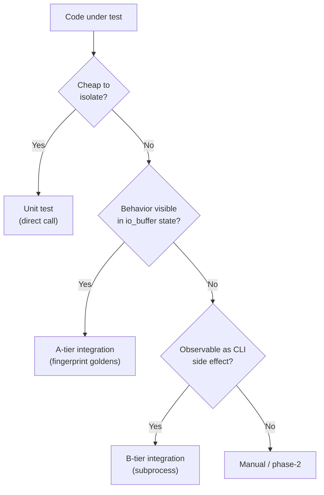

+++
title = "Tier Model"
weight = 10
+++

# The Four-Tier Model

Each tier targets a specific failure mode. The boundaries between them are drawn around **cost-of-setup**, not around the type of code under test — a stateful component can sit in unit tests as long as its setup is cheap, and a "pure" function can sit at the A-tier level if isolating it from the simulation environment is more expensive than running the simulation.

## Unit tier — direct exercise

**Location**: `tests/unit/<module>/`. Each subdirectory is one test executable.

**Rule of admission**: if mocking the dependencies costs more than the value the test delivers, the test belongs in A-tier. The unit tier is for code whose state can be set up in tens of lines.

**Current coverage**:

| Subdirectory | Subject |
|--------------|---------|
| `tests/unit/cli/` | `coast::cli::parse` — argv permutations, malformed input, defaults |
| `tests/unit/json_cfg/` | `json_loader` — fixture-driven config parsing |
| `tests/unit/probe/` | `probe_instance` decimation, `spsc_queue` push/pop semantics |
| `tests/unit/coast_compare/` | The comparator itself — match, fail, structural error, multi-version logic |
| `tests/unit/test_support/` | `blob_writer` — round-trip JSON + binary-sidecar references |
| `tests/unit/io/` | `sample_sequencer` — sequential/shuffle semantics, index-manifest behavior (load_index_manifest parsing + rejection, save/load resume parity with manifests, legacy-cursor mapping), and the mnist_io manifest seam test |
| `tests/unit/hd_ngm3/` | `frozen_inert` — drives `compute_step` directly via a test subclass; compares whole `save_state` trees (via `mem_state_writer` / `mem_group operator==`) minus rng/neuron_rgens groups; unfrozen negative control; verifies `load_state` restores the checkpoint lr regardless of `frozen`. `cold_init` — pins the cold RNG contract the CPU and GPU group share against a spelled-out reference, and that the CPU group's initial state is exactly `cold_init`'s. `gpu_readback_faults` (and its ngm25 twin in `tests/unit/hd_ngm25/`) drive the GPU group on `fault_gpu_device`, an in-memory `gpu_device` — built for the webgpu and null backends, but needs no adapter, so it runs in the sandbox |
| `tests/unit/sim_core/` | `run_manifest` — happy-path field contract, including the `datasets` mirror of active dataset configs |
| `tests/unit/tools/` | `metric`/`distortion`/`ensemble_code`/`histogram` (Metric Explorer) + `metric_registry` metadata |
| `tests/unit/h5browse/` | 11 test executables (plus the manual benchmark `bench_h5b_kernel_throughput`): `scalar_type`, `scan_stats` (Welford equivalence/merge), `base_histogram` (rebin invariant, NaN/Inf exclusion), `row_filter` (all ops), `file_model` (family detection, real-writer round-trips), `chunk_cache` (LRU/budget/`shared_ptr` liveness), `dataset_reader`, `pairwise` (sampled-vs-full equivalence, cancel, cosine domain), `scan_engine` (headless e2e: convergence, cancel, per-dataset containment), `console_api` (the range-style façade an embedded interpreter reaches through `open()`), `malformed` (the retained G6 corrupt-file corpus) |

**What unit tests deliberately do not cover**: the neural model internals (`neuron_group::process()`, dendrite update rules, segment-tree maintenance). These are research-driven and still subject to change; pinning their implementation details in unit tests would lock in implementation accidents as contracts. Their behavior is observed at the A-tier through `io_buffer` fingerprints.

## A-tier integration — the regression tripwire

**Location**: `tests/integration/<test>/`. Each subdirectory is one (config, seed-offset) pairing.

**What it does**: builds a real `sim::env` via `coast::app::build_env`, runs it for N steps inside the test process, fingerprints the resulting `io_buffer` state, and compares that fingerprint against retained goldens via `coast_compare`. See [Golden Protocol]({}) for the comparison semantics.

**Current matrix**:

| Test | Config | Notes |
|------|--------|-------|
| `integration.mnist_seed0_baseline` | `configs/mnist.json` | 100k steps, seed 0 |
| `integration.mnist_seed1_baseline` | `configs/mnist.json` | 100k steps, seed 1 |
| `integration.mnist_seed2_baseline` | `configs/mnist.json` | 100k steps, seed 2 |
| `integration.mnist_ngm3_philox` | `configs/mnist_ngm3_philox.json` | 10k steps, seed 0; strict CPU reference for the three below |
| `integration.mnist_ngm3_cpu_to_gpu` | `configs/mnist_ngm3_cpu_to_gpu.json` | 10k steps, seed 0; aggregate compare, label `gpu` (webgpu builds only) |
| `integration.mnist_ngm3_gpu_to_cpu` | `configs/mnist_ngm3_gpu_to_cpu.json` | 10k steps, seed 0; aggregate compare, label `gpu` (webgpu builds only) |
| `integration.mnist_ngm3_heterogeneous` | `configs/mnist_ngm3_heterogeneous.json` | 10k steps, seed 0; aggregate compare, label `gpu` (webgpu builds only) |
| `integration.mnist_ngm25` | `configs/mnist_ngm25.json` | 10k steps, seed 0 |
| `integration.frozen_inert` | mnist, ngm2 + ngm3 via `build_env` | Self-comparing: asserts `state(t) == state(t+N)`. **No goldens.** |
| `integration.frozen_inert_gpu` | mnist, ngm3 GPU | Same self-comparing pattern; `_gpu` suffix excludes it from sandboxed runs. Sole exclusion: the step counter. |
| `integration.impl_equivalence` | in-process, dataset-free; ngm2 + ngm25 + ngm3 CPU | Cross-implementation differential test (SPEC.md M.0.6). **No goldens.** |
| `integration.impl_equivalence_gpu` | as above, plus ngm25 GPU + ngm3 GPU | webgpu builds only, label `gpu`. **No goldens.** |
| `integration.seed_composition` | four configs covering `mnist_input`, ngm2, ngm3 and ngm25 groups (CPU) and retina | Seed offsets compose modulo 2^32 and the reported effective seed is the one the RNG uses; self-comparing. **No goldens.** |

Three seeds is the minimum that prevents a seed-specific algorithmic accident from being mistaken for a regression: a bug that perturbs all three is genuinely different from a bug that perturbs one. The original Discover goal of "every config × {0,1,2}" was scoped down during Develop to keep the wall-clock budget below 15 minutes; widening the matrix later is a one-line CMake addition per (config, seed) pair.

**Self-comparing tests (no goldens).** `frozen_inert` and `frozen_inert_gpu` run a frozen model N steps, snapshot state, run N more, snapshot again, and assert the two are identical (except the step counter). The expected value is the model's own prior state, not a retained baseline, so these need no golden files and never re-baseline. Shared helpers: `tests/integration/frozen_inert/frozen_inert_helpers.h`.

**Cross-implementation equivalence (no goldens).** `impl_equivalence` builds one group of each implementation (ngm2, ngm25, ngm3 CPU), injects one canonical set of initial permanences through each group's own `save_state`/`load_state`, neutralises the randomness (winner threshold 1, constant neuron noise, max_softmax, inputs that are exactly 0 or in [max/2, max] so the low-input penalty is deterministic), and compares outputs and logical state — keyed by (neuron, dendrite, segment id, input index) — after every step. The expected value is the other implementations, not a retained baseline. It covers the response (frozen), learning, winner-only learning, the first branch event, a permanence exactly at the threshold, and a group output that sums to 0. `impl_equivalence_gpu` (webgpu builds, label `gpu`) runs the same cases with ngm25-GPU and ngm3-GPU added. For long real runs, `ngm_parity_probe` (tests/integration, not in ctest) prints per-seed output and logical learned-state statistics for any one neuron group, for a two-sample comparison of implementations. A few cases test the stochastic draws instead: the penalty draw granularity (step by step where two implementations share draws, by an equivalence test on the mean otherwise), the uniform winner among tied neurons (a χ² test per implementation, SPEC.md M.4.4), who wins against the exact win probabilities of `win_act` ~ U(mx·t, mx) plus that choice (χ²), the neuron noise (two-sample KS tests on the per-step output under silent input, every pair), and, comparing each implementation with itself, a checkpoint resumed under a changed configuration (M.7.8).

**Why in-process**: a test that builds the env directly can probe internals without parsing a binary's output, and a single process boots once and runs the sim. Subprocess invocation would multiply the build-env cost by every test and lose direct access to state. The cost is a hard dependency on `libcoast` being a usable static library (see [Decisions]({})).

**What A-tier catches**: any change that perturbs the recorded fingerprint. By construction this is a localizer, not a coverage guarantee — see the corresponding caveat in [Golden Protocol]({}#what-a-fingerprint-cannot-tell-you).

## B-tier integration — the CLI surface

**Location**: `tests/integration_b/`. All cases share a single binary, `test_b_tier`.

**What it does**: each `TEST_CASE` forks the built `coast` binary with a specific argv combination, captures stdout/stderr/exit code, and asserts on observable outputs (exit code, presence of files, content of `--log-buffers` output, etc.).

**Why subprocess**: A-tier tests build `sim::env` directly and never exercise the executable. A regression in `main.cpp`'s argv plumbing, in `coast::cli::parse`'s error paths, or in the `--save-state` / `--load-state` / `--checkpoint` / `--log-buffers` file mechanics is invisible to A-tier. B-tier is the only thing that runs `./coast` as a user does.

**Why one shared executable**: the per-case cost is dominated by the subprocess fork+exec, not by doctest startup. Compiling N separate test binaries would multiply build cost without changing run cost.

## GUI smoke — deferred

**Location**: `tests/smoke/`, currently containing only `test_doctest_link.cpp` (link sanity).

**Status**: per-component construct-and-tick smoke tests are **deferred**. The Develop stage stopped at link-sanity coverage; full GUI smoke is to be revisited on the next GUI refactor or a crash regression.

**Why deferred and not removed**: the design (real SDL/GL window, doctest's main-thread `TEST_CASE` execution, one frame per component) is sound. The deferral is purely a "out of time this cycle" call, not a "not worth doing".

## What no tier covers

By deliberate choice, no automated test in this iteration covers:

- **Numerical correctness of the neural model** against an independent spec. The contract is "what the current code produces", not "what HD-NGM2 should produce".
- **Performance regressions**. The `benchmarks/` directory is the workflow for that; the test suite does not enforce throughput.
- **Visual output**. Image-diff against rendered visualizations was considered and deferred to phase-2 (cost of headless GL + golden staleness + cross-driver pixel variance vs. value delivered).
- **Cross-platform bit-exact reproducibility**. Tolerance-based comparison absorbs Linux/macOS FP drift; we do not assert byte-equality.
- **The test infrastructure itself**. No meta-tests. `coast_compare` is unit-tested as a normal component, but `blob_writer` round-trips, golden rotation scripts, and the CMake glue are validated by use, not by tests-of-tests.
