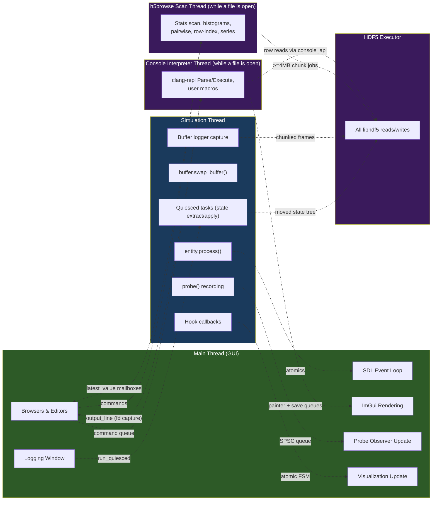

+++
title = "Threading"
weight = 30
+++

# Threading Model

COAST uses **five threads**: the main (GUI) thread, the dedicated simulation thread, the `hdf5::executor` worker that serializes all libhdf5 access (the library is built without thread safety), the [HDF5 Browser]({})'s scan thread, which exists only while the browser panel has a file open, and the [console]({})'s interpreter thread, which exists only while the C++ console has a file open (and only in builds where LLVM was found). Communication between GUI and sim is lock-free in the steady state. Understanding the thread boundaries is critical for working with this codebase.

The last two are **tool threads**: they belong to offline analysis panels, are absent during a plain simulation run, and never touch sim state — they reach the rest of the process only through the executor.

{}
**[coastd]({}) is not on this map.** The daemon is a
*separate process* with its own threads — a single-writer state core, a bounded
worker pool, a supervisor poll thread, and thread-per-connection comms. It shares
nothing with the threads below except files on disk, and when it runs a `coast`
child, that child is an ordinary headless process with the ordinary main+sim
threads. See [coastd → Architecture]({}#threads).
{}

## Thread Map



## What Runs Where

| Component | Thread | Notes |
|-----------|--------|-------|
| SDL event polling | Main | `SDL_PollEvent()` |
| ImGui frame lifecycle | Main | NewFrame → Render → Draw |
| `gui_manager` rendering | Main | Menu bar, dialogs, status bar |
| Browser windows | Main | Entity, buffer, dataset browsers |
| Probe observer drain | Main | `probe_browser.update()` |
| Visualization update | Main | Copy data during `update()` |
| `env::process()` | Sim | CPU entity `process()` calls via TBB `parallel_for` (persistent `affinity_partitioner`) + GPU phase 1 (serial record/submit, then rendezvous `wait_idle` after the CPU batch) |
| `env::swap_io()` | Sim | GPU phase 2 (cross-device sync) + all buffer swaps |
| GPU kernel record/submit/`wait_idle` | Sim | wgpu work happens entirely on the sim thread |
| `probe()` / `read_probes()` | Sim | SPSC queue push; GPU probe readback (gated) |
| Post-swap hooks | Sim | Visualization sync, buffer capture, GPU→CPU vis readback |
| Buffer logger capture | Sim | Via post_swap hook; on-demand GPU readback for GPU-only buffers. Stopped by detaching the hook inside `run_quiesced` (#197; since #235 hook removal is synchronous anyway); stats published via atomics |
| State extract / apply | Sim | Inside a `run_quiesced` task at the post-swap boundary |
| State serialize / parse (HDF5) | Executor | Tree → file (async, future) / file → tree (`submit_sync`) |
| Buffer-browser stats, status-dialog strings | Sim | post_swap hook + `demand_published` slot; GUI reads the published copy |
| h5browse stats/histogram/pairwise/row-index/series scan | h5browse scan thread | Submits ≥4 MB whole-chunk read jobs to the executor; accumulates itself; publishes snapshots via `latest_value` mailboxes |
| h5browse table-view block fetches | h5browse scan thread | Serviced *between* batches of any running analysis op (two-lane servicing) so the table stays live during long scans |
| clang-repl `Parse`/`Execute`, user macros | Console thread | Created by `console::session`; every GUI-side command is a non-blocking enqueue, so a macro scanning a multi-GB dataset never freezes the window |
| Console `printf` / `cout` / Clang diagnostics | Console thread → Main | Captured by dup'ing the process stdout/stderr fds onto a pipe; a **background reader thread** drains it (else a chatty macro deadlocks on a full pipe buffer). GUI polls `drain_output()` |
| Console plot `save_png` / `save_h5` | Console thread → Main | Console side only *enqueues*; the GUI thread renders the FBO and hands HDF5 writes to the executor — and must do so **outside** an active ImGui frame |

## Communication Mechanisms

### 1. Lock-Free Atomics

`sim_thread_controller` uses atomics for all control:

| Atomic | Direction | Ordering | Purpose |
|--------|-----------|----------|---------|
| `mode_` | GUI → Sim | release/acquire | Mode control |
| `target_sps_` | GUI → Sim | release/acquire | Speed setting |
| `step_count_` | Sim → GUI | relaxed (write), acquire (read) | Step counter |
| `actual_sps_` | Sim → GUI | relaxed (write), acquire (read) | Measured speed |
| `single_step_pending_` | GUI → Sim | release/acquire | Single step request |
| `step_limit_` | GUI → Sim | release/acquire | Auto-pause target |
| `halted_` | Sim → Any | release/acquire | Sticky: a per-step fault or a failed runtime state load halted the run (§6); forces paused, surfaced via `get_fault()` |
| `quiesced_pending_` | Any → Sim | release/acquire | Quiesced task queued (lock-free fast-path flag) |
| `sim_thread_id_` | Sim → Any | release/acquire | Published once at thread start; backs the self-deadlock assert |

### 1b. Quiesced Tasks (`run_quiesced`)

`set_mode(paused)` only stores an atomic and returns — the sim thread may still be mid-step. Code that must touch a **quiescent** sim (state save/load, checkpointing, `set_step_count`) calls `sim_thread_controller::run_quiesced(fn)`: the closure is enqueued on a small MPSC queue, the sim thread runs it **on the sim thread at the next quiescent boundary**, and the caller blocks until it completes, receiving `fn`'s result (or its rethrown exception).

The boundary is the coherent post-swap point — right after a `do_step()` (process + swap_io) fully completes, or, when the sim is not stepping, while parked in the `paused` wait (an enqueue wakes the thread). Because `fn` executes on the sim thread at that boundary it may freely touch state the sim thread owns: io_buffer read pages, the wgpu queue (readbacks/uploads), entity `save_state`/`load_state`, and the step counter. No step runs for `fn`'s duration; the controller's mode is never modified.

This is the **single quiescence seam** for all requester-initiated, one-shot access to sim state. Its complement for *periodic* publication is the hook system (§3): hooks fire at the same post-swap boundary, but asynchronously, every step, with no waiting requester.

Implementation notes: the queue shares `wake_mutex_` with the park predicate; `quiesced_pending_` lets the hot stepping loop check "any task?" with a single atomic load. Tasks run one at a time in FIFO order. `run_quiesced` must not be called on the sim thread itself (self-deadlock; asserted via `sim_thread_id_`). During teardown a latched stopping flag makes late callers throw instead of blocking on a thread that will no longer drain (the stop-escape).

### 2. SPSC Queues (Probe Data)

Each active probe has a `spsc_queue<probe_sample>` with capacity 4096:
- **Producer** (sim thread): `try_push()` with release on head
- **Consumer** (GUI thread): `drain()` with acquire on head
- **Drop policy**: If full, values are silently dropped

### 3. Deferred Hook System

Hooks are registered by the GUI thread but execute on the sim thread. Registration is deferred; removal is synchronous:

1. **GUI thread** (add): Acquires `pending_hooks_mutex_`, pushes hook into pending vector, sets `has_pending_hooks_ = true` (release)
2. **Sim thread**: At the top of `process()` and `swap_io()`, checks `has_pending_hooks_` (acquire). If true, acquires both mutexes, moves pending hooks to active maps, clears pending vectors
3. **Sim thread**: Runs each hook phase holding `active_hooks_mutex_` (uncontended in the steady state)
4. **Any thread** (remove): Acquires `active_hooks_mutex_` — waiting out a running phase — and erases the hook directly, so on return the hook can no longer run (#235). From inside a hook the removal is deferred to the next boundary instead.

`pending_hooks_mutex_` is only acquired when hooks are actually being added/removed — in the steady state, the sim thread does a single atomic load for it, plus one uncontended `active_hooks_mutex_` lock per phase. See [Hook System]({}) for what a removal can wait for.

### 4. Visualization Atomic FSM

Visualizations (ngm_flat_vis, ngm_tree_vis) use a 3-state atomic:

```
idle → requested → updating → idle
```

- **Sim thread** (post_swap hook): CAS `idle → requested`; the barrier hook then yields until `idle`, cancelling `requested → idle` after 100 ms if the GUI has not started
- **GUI thread** (`update()`): CAS `requested → updating`, copies data, CAS `updating → idle`

### 4b. Demand-Driven Publish (`demand_published<T>`)

For polled GUI displays — the buffer browser's per-buffer stats and the status dialog's per-entity strings — a `demand_published<T>` slot (`include/core/demand_published.h`) sits between a gated post_swap hook (producer, sim thread) and the rendering window (consumer, GUI thread):

- The hook calls `produce_if_wanted(compute)`: it recomputes and republishes **only if the GUI has consumed the previous value** (a `fresh_` atomic the hook sets and the consumer clears). Otherwise it early-returns on one atomic load. The expensive work therefore runs at the GUI's consumption rate (~frame rate), not the much higher step rate — and not at all while the window is closed.
- The GUI calls `consume()` once per frame: reads the latest value (a mutex guards only the value against a torn read; it never gates production) and requests the next.

Because the compute runs on the sim thread at post-swap, it may use `read_back_sync()` — so GPU-only buffers get real stats. The slot is held via `shared_ptr` and captured by value in the hook, so its lifetime does not depend on hook removal timing. Hooks are registered/removed with window visibility.

### 5. TBB Concurrent Hash Map (Probes)

`entity_probe_set` uses TBB's `concurrent_hash_map`:
- **Sim thread**: `const_accessor` (reader lock) for `record()` — concurrent reads are non-blocking. `record()` only looks up; it never inserts.
- **GUI thread** (headless: the run loop): `accessor` (writer lock) for `discover()`, `activate()`, `deactivate()`. The same thread appends each new instance to a plain `std::vector` (`list_`), which `update_observers()` / `all_instances()` traverse.

`concurrent_hash_map` allows lookup concurrent with insertion, but not traversal concurrent with either: an insert, and also a lookup, which may lazily rehash a bucket and move its nodes under an unlocked iterator. So the map is only ever looked up, and the traversals walk `list_`, which the sim thread never touches. Before #249 `record()` inserted on first sight of a probe and the traversals walked the map: the traversal could read an instance whose pointer was not yet set and crash, or see an instance twice or miss it during a rehash.

### 6. Hot-Path Fault Channel (`std::expected`)

Per-step errors are reported **by value, not by throwing**. The project builds `-O3`
with `NDEBUG`, so a plain `assert()` is a no-op in the binaries that run — the hot
path had no working error report. `io_entity::process()` (and `env::process()` /
`env::swap_io()`) now return `sim::step_result` (`std::expected<void, core::step_error>`);
in-place hot-path invariants use `COAST_REQUIRE(cond, kind)` (always compiled in),
which returns `std::unexpected` from the enclosing function on violation.

Flow on the sim thread:

1. **Entity** — `process()` hits a `COAST_REQUIRE` (or a GPU `device_fault`) and returns `std::unexpected{step_error}` (or throws; see below).
2. **`env::dispatch_cpu_entities()`** — reduces the per-entity results allocation-free: a single relaxed `std::atomic<bool> cpu_fault_` (reset+read once per step) plus a `cpu_fault_mutex_`-guarded `step_error` written **only on the cold fault branch**. The happy path performs no per-step allocation and no shared write beyond the two relaxed atomics. The reported fault is the one with the **smallest `entity_id`** — a scheduling-independent (deterministic) choice that matters for the bit-determinism / golden contract.
3. **`do_step()`** — on a faulted `process()`/`swap_io()` it calls `record_fault()`: stores the first fault (sticky) under `fault_mutex_`, sets `halted_` (atomic), forces `mode_ = paused`. `thread_main` keeps re-forcing paused so an external `set_mode()` cannot resume a faulted run.
4. **Surfacing** — `is_halted()` / `get_fault()` (lock-free flag + mutex-guarded payload). Headless reports the fault to **stderr** and exits non-zero. In the GUI, the Simulation Control window names the fault and disables play and step, and the status bar shows "Halted"; reloading the configuration builds a fresh controller.

An **exception** thrown during a step takes the same path instead of reaching `std::terminate` (#198). `dispatch_cpu_entities()` catches a throw from each entity's `process()` and turns it into a `step_error` of kind `exception`, stamped with the entity's id; it joins the reduction like a returned fault, does not cancel the other entities, and leaves an in-flight GPU batch to reach its rendezvous. `do_step()` wraps the whole step in a backstop catch for everything else (hooks, `swap_io()`, the GPU host loop), which records kind `exception` with no entity. Both log the exception's message (`[ERROR][sim]`) where they catch it, since `step_error` carries no message. Entities should still report known invariant violations by value; the catch is insurance for a throw that slips through, e.g. `mnist_db::get_norm_image` on an index from a corrupt checkpoint.

A runtime state load that fails partway uses the same halt. `logging_manager::load_state` applies the checkpoint inside a `run_quiesced` task; if an entity's `load_state` throws, the entities applied before it stay applied, so the task calls the public `halt(step_error)` (kind `partial_load`) right there, on the sim thread. No step can run on the partly loaded env, and no `load_state` needs to be atomic. The startup load (`build_env`) is not affected: it exits 1 on failure.

The cost is fixed at **K-entity granularity** (entity count, single digits) per step, not synapse granularity, so it never enters the inner compute loop — measured within the SPS noise floor (see `benchmarks/perf_error_handling.md`). Cold paths (constructors, dataset loaders, config validation) keep using exceptions, which `build_env` catches and reports.

### 7. h5browse Scan Thread + Two-Lane Servicing

The [HDF5 Browser]({}) (Analysis menu) is entirely independent of the simulation and its thread. Opening a file spins up **one scan thread**, owned by `h5b::scan_engine`, that submits ≥4 MB whole-chunk read jobs to the same process-wide `hdf5::executor` sim logging uses — the two interleave fairly in the executor's FIFO queue, so a heavy browser scan slows a running sim rather than racing it.

Two command lanes share the one scan thread: **analysis** operations (open, stats scan, histograms, pairwise, row-index, series) are strictly serialized and cancellable per batch via an atomic flag; **table-view block fetches** are serviced *between* analysis batches, so scrolling the raw-data table stays responsive during a long scan. Results reach the GUI thread through `latest_value<shared_ptr<const T>>` mailboxes — unconditional latest-state-wins per-frame `consume()`, deliberately **not** `demand_published<T>` (§4b): that primitive's contract needs a producer that keeps re-offering after every consumption, which an event-driven scan (publish once per completed batch) does not provide. A separate mutex-guarded ring buffer carries diagnostic log lines, and the byte-budgeted chunk cache hands out `shared_ptr<const row_block>` so a block evicted between frames still outlives the frame that is drawing it.

## GPU Work Lives on the Sim Thread

When a `gpu_context` is present, **all** wgpu interaction happens on the simulation thread — no new thread is introduced. Each step records kernels into a command encoder and submits once per phase. In `process()` the submit does **not** block: the CPU entities run via TBB `parallel_for` (with a persistent `affinity_partitioner`) while the GPU batch is in flight, and the sim thread reaches `wgpuDevicePoll(..., wait=true)` (`gpu_context::wait_idle()`) only afterwards — so CPU and GPU overlap within `process()`. `swap_io()` still **blocks** on `wait_idle()` immediately after its submit. GPU recording itself stays serial (one shared encoder is not safe for concurrent `record()`). See [GPU Dispatch]({}).

GPU faults (device-lost, validation errors) are flagged asynchronously on `gpu_context.faulted_` (atomic) from wgpu-internal threads and surfaced on the sim thread at the next phase boundary via `gpu_device::check()`, which returns a `device_fault` on the value-based fault channel (§6) instead of throwing. The webgpu backend's `check()` is the single try/catch firewall: it logs the driver detail to stderr and returns the categorized fault, so no exception unwinds out of `env::process()`/`swap_io()`.

### GPU Readback for the GUI

The GUI thread never touches wgpu. Three readback paths bridge GPU-resident state to it, all executed on the sim thread:

- **Probes / OBSERVE** — `read_probes()` runs after the phase-1 submit and pushes values into the existing SPSC queues, but only performs the GPU→CPU copy when a probe (or observe) is active.
- **Time Series visualization of a GPU-only buffer** — a pure `io_buffer_gpu` has no CPU page, so the Time Series vis sets `needs_readback_` at construction and, in its **post-swap hook**, calls `read_back_sync()` into a CPU mirror while the GPU is idle (the readback rides the per-step barrier wait). The GUI thread then reads the mirror through the same 3-state atomic FSM used for the other visualizers.
- **NGM mirror** — `neuron_group_gpu_t::refresh_vis_mirror()` is pulled on demand by the visualizer during the post-swap barrier window (possibly very infrequently); the entity never auto-refreshes.

State save/load follows the same rule: buffer `snapshot()`/`restore()` and GPU-entity `save_state`/`load_state` issue queue operations, so they run inside a `run_quiesced` task — on the sim thread, the queue's sole owner — never on the requester's thread.

## Thread Safety Rules

1. **Never access entity internal state from the GUI thread** — always copy via hooks or SPSC queues
2. **State save/load goes through `run_quiesced`** — extraction and apply run on the sim thread at the quiescent boundary; pausing via `set_mode` alone is asynchronous and not sufficient. (Sole exemption: `build_env`'s startup load, which runs before the sim thread has ever stepped — see [Logging Pipeline]({}).)
3. **Visualization data is copied, never shared** — the FSM ensures exclusive access during copy
4. **Probe observers are GUI-thread-only** — `push()`, `render()`, and observer management all happen on the main thread
5. **Hook registration is safe from any thread** — the deferred system handles the synchronization. **Removal returns only once the hook can no longer run**, so an owner may free what its hook captures right after `remove_*_hook()`; a hook must never wait on another thread without a timeout, or a removal from that thread deadlocks (#235)

## Shutdown Sequence

```
1. User closes window → running = false
2. Main loop exits
3. Shutdown callbacks:
   a. gui.set_sim_instance(nullptr) → frees GL resources
   b. sim.reset() → destroys sim_instance:
      i.   logging_manager destroyed
      ii.  thread_controller: request_stop() + notify_all() + join
      iii. sim_builder, sim_env, json_loader destroyed
4. sdl_app destructor: cleanup ImGui, SDL
```

The key insight: `thread_controller` is destroyed before `sim_env`, so the simulation thread is guaranteed to be joined before any entities or buffers are destroyed.
